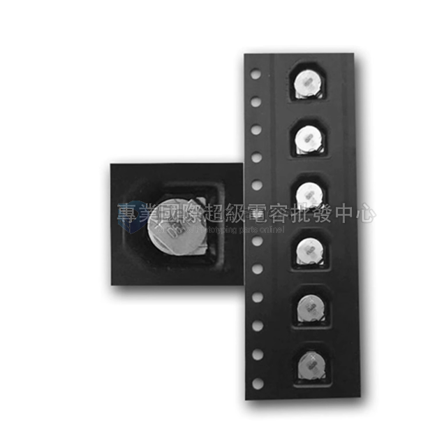
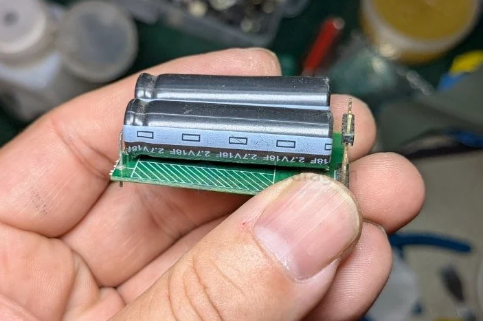
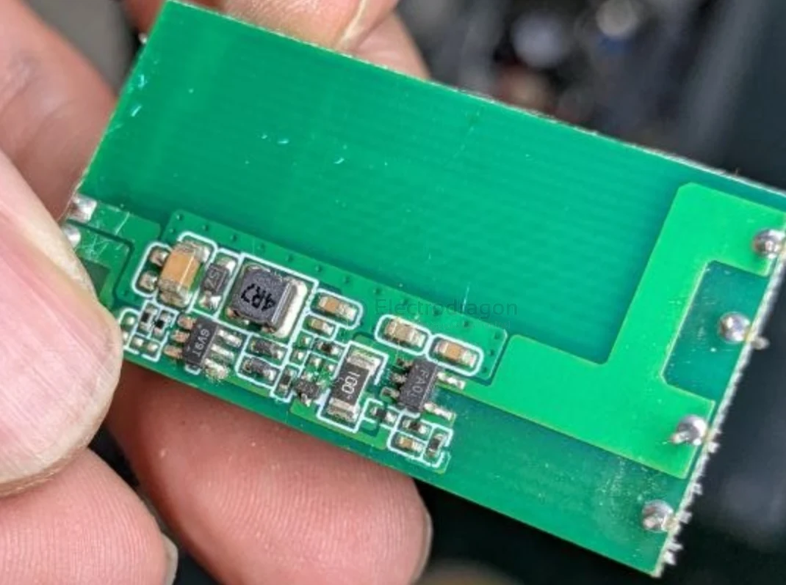

# capacitor-super-dat

== super-cap == super cap 

## calculation 

LSUC2.7V3000F * 4 

关键取决于接法和截止电压。按“4 串 + 降压到 5V”这种最常见用法，答案是：
结论：约 1.5 小时（90 分钟）
4 串：C = 3000 / 4 = 750 F，Vmax = 10.8 V
总储能 = ½CV² = 0.5 × 750 × 10.8² = 43,740 J = 12.15 Wh
从 10.8 V 放到 6 V，可用能量 30.2 kJ = 8.4 Wh
负载 5 W，效率 90% → 输入 5.56 W → 91 分钟
不同截止电压下的续航

放到	可用能量	85% 效率	90% 效率	95% 效率
7.0 V	25.4 kJ	72 分	76 分	80 分
6.5 V	27.9 kJ	79 分	84 分	88 分
6.0 V	30.2 kJ	86 分	91 分	96 分
5.5 V	32.4 kJ	92 分	97 分	103 分
5.0 V	34.4 kJ	97 分	103 分	109 分

决定续航的因素是降压芯片能工作到多低的输入电压。芯片最低输入为 6V 时，续航约 90 分钟；能撑到 5.5V 时约 100 分钟；如果换成宽输入器件，续航时间还能再增加约 10%。
如果改成 4 并 + 升压
总能量完全一样（43.7 kJ），但能放电更深，续航明显更长：

放到	可用能量	90% 效率
2.0 V	19.7 kJ	59 分
1.5 V	30.2 kJ	91 分
1.0 V	37.7 kJ	113 分
0.9 V	38.9 kJ	117 分

原因是超级电容的能量与电压的平方成正比（E = ½CV²），放到 1V 还能再榨出 30% 的能量。
但代价也很明确：升压芯片输入端在 2.7V 时就要 2A 电流，在 1V 时要 5.5A，开关管的应力和效率都会迅速恶化。所以串4+降压是主流做法，并4+升压只在“必须榨干最后一滴”时使用。

### 三个必须注意的点

#### ① 串联必须加均压
4 只 2.7V 单体串联后，只要有一只先到 2.7V，继续充电就会让它的电压超过 2.7V，导致寿命骤降、鼓包、甚至漏液。必须加被动均压板（2.5V 起分流 20–50mA）或主动均衡。这是最容易出问题的地方。
#### ② 不能用 LDO/线性稳压
10.8 V 降到 5 V，效率只有 46%
1 A 时线性管要散 5.8 W 的热，还得随电压下降不断变化
必须用同步 buck，而且选型要看最低输入电压（很多 buck 在 Vin 接近 Vout 时会掉出调节）。
#### ③ 充电也要算
等效电荷 Q = C·V = 750 F × 10.8 V = 8,100 C = 2.25 Ah
2 A 恒流充电约 1.1 小时（还要算 CV 阶段）
充电时必须限压 10.8V（单体 2.7V），并且限流，否则大电流冲击对电容和电源都不好。

### 现实提醒

12.15 Wh 的名义储能 ≈ 一颗 3350mAh 手机电池（12.4 Wh）
实际只能用到 8.4 Wh（6V 截止）→ 利用率 69%
也就是说：这 4 只 3000F 电容的总电量，跟一块普通手机电池差不多。超级电容的真正价值在于瞬时大电流、无损循环、低温可用；它不适合储能续航。如果你希望 5V/1A 供电两个小时以上，用锂电池（18650 ×2 或一节 12.4Wh 的软包）更轻、更便宜、体积也更小。
反过来说，如果你的场景是短时掉电维持（市电断了要撑 30 秒做数据落盘/安全关机），那这个配置就超额满足——90 分钟的续航也足够。
需要我按你的实际需求算一版吗？告诉我：降压芯片型号或最低输入电压、需要撑多久、充电电流，我给出四串还是并联的建议，以及均压板和限流充电的具体方案。

## 2.7v super capacitor

- 2.7v1.0F 6.3*12（1个）
- 2.7v1.0F 8*12（1个）
- 2.7v1.5F 6.3*12（1个）
- 2.7v2.0F 8*12（1个）
- 2.7v3.3F 6.3*22（1个）
- 2.7v3.3F 8*20（1个）
- 2.7v4.0F 6.3*23（1个）
- 2.7v5.0F 8*20（1个）
- 2.7v5.0F 10*16（1个）
- 2.7v7.0F 8*25（1个）
- 2.7v7.0F 10*21（1个）
- 2.7v10F 10*25.5（1个）
- 2.7v15F 12.5*25（1个）
- 2.7v20F 12.5*25（1个）= 3.2 
- 2.7v30F 12.5*31（1个）

- 黑2.7V0.3F（10个）
- 2.7V1F（5个）
- 2.7V2F（5个）
- 2.7V3F（5个）
- 3V3F（2个）
- 2.7V3.3F（5个）蓝色
- 3V3.3F（2个）
- 2.7V4F（5个）
- 2.7V4.7F（5个）
- 2.7V5F（1个）
- 2.7V7F（2个）
- 2.7V10F（1个）
- 2.7V15F（1个）
- 3V15F（1个）
- 2.7V18F（1个）
- 3V20F（1个）
- 2.7V22F（1个）
- 2.7V25F（1个）
- 2.7V30F（1个）
- 2.7V35F（1个）
- 2.7V40F（1个）
- 2.7V70F（1个）
- 2.7V100F（1个）= 7 

## XH414

- Brand: Seiko Corporation (SII)
- Model: XH414H-1V01E
- Specifications: Thickness 1.4, Diameter 4.8
- Capacitance: 0.08F
- Voltage: 3.3V
- Charging time: 30min
- Weight: 0.07g
- Internal resistance: 80-100 ohms
- Operating temperature range: -20~60 degrees Celsius

## board 

FA0i == XC6225-3.6V 

The FA0i marking code on a SOT23-5 (or SOT-25) package generally corresponds to the XC6225A362MR-G from Torex Semiconductor or a compatible device. - [[Torex-dat]] - [[XC6225-dat]]

GV9T == ???

## ref 

- [[super-cap]]

- [[battery]]