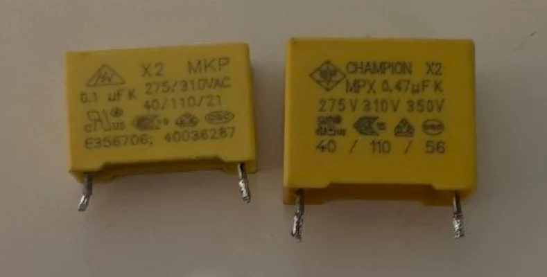

# capacitor-x2-dat

- [[capacitor-x2-dat]] - [[protection-acdc-dat]] - [[capacitor-dat]]

- [[capacitor-x2-dat]] - [[protection-acdc-dat]] - [[HAWRRY-dat]]

An X2 capacitor is a safety-rated EMI suppression capacitor designed to be connected across the AC mains (Line–Neutral).

It is defined by IEC 60384-14 and used mainly for noise suppression and interference filtering in power supplies and AC equipment.

Where X2 capacitors are used

    AC Line (L) ──||── AC Neutral (N)
                ↑
                X2

Typical locations:

- Across L–N in SMPS input
- EMI filters
- Appliances, chargers, adapters
- Motor controllers

What “X2” specifically means

| Parameter                | X2 Rating                     |
| ------------------------ | ----------------------------- |
| Connection               | Line ↔ Neutral                |
| Rated AC voltage         | ≤ 300 VAC (typically 275 VAC) |
| Surge voltage capability | 2.5 kV                        |
| Failure mode             | Self-healing, non-flammable   |
| Safety standard          | IEC 60384-14                  |

一、 为什么 X2 电容在 PCB 上非常常见，而 X1 不常见？

X电容跨接在交流电网的火线（L）和零线（N）之间，主要用于抑制差模干扰。国际标准（IEC 60384-14）将 X 电容按脉冲耐压等级细分为 X1、X2、X3：

耐压能力不同：

X1 电容： 能够承受大于 4 kV 甚至高达 8 kV 的高压脉冲冲击。

X2 电容： 能够承受最高 2.5 kV 的脉冲冲击。

应用环境与“过电压类别”：

家庭和办公室（日常电子设备）： 属于“过电压类别 II”。电网进入房屋后，经过配电箱、长导线和插座，绝大多数雷击浪涌或电网瞬时尖峰电压已被衰减到较低水平。在正常的消费电子（如充电器、电视、电脑电源）中，峰值浪涌很少超过 2.5 kV。因此，X2 的耐压性能完全够用。

工业或配电前端： X1 通常用于重工业环境、三相配电系统，或者直接靠近户外进线端、承受严苛雷击风险的场景。

体积与成本的权衡：

为了承受更高的脉冲电压（>4kV），X1 电容内部的介质厚度和结构设计必须更厚、更扎实，导致它的体积明显更大、价格更高。

在民用消费级 PCB 上使用 X1 属于“过度设计”，不仅占用宝贵的板上空间，还会增加不必要的BOM成本。因此，99% 的日常开关电源都选用 X2。

## X2 

- [[capacitor-X-Y-dat]] - [[capacitor-dat]] - [[CR6842-dat]]

- [[Capacitor-X2-dat]]  275V 310V 350V 

0.1UF 0.47UF

## ref 

