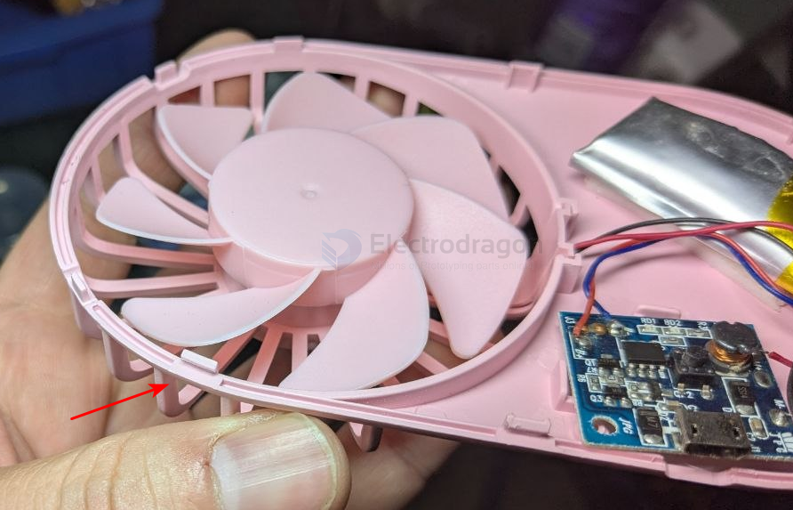
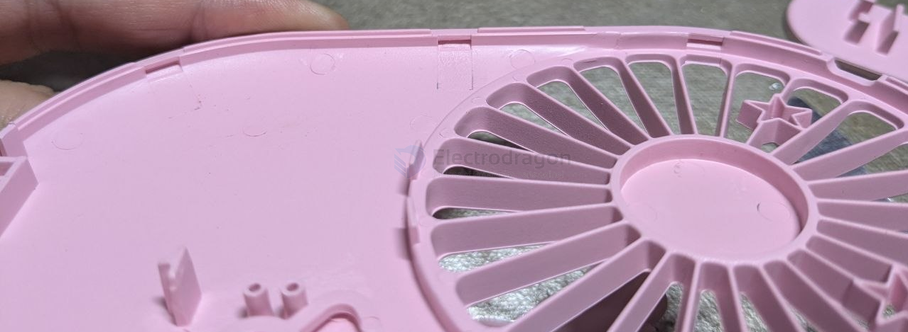
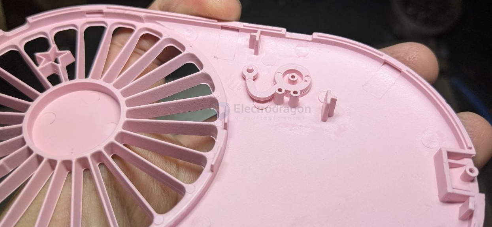
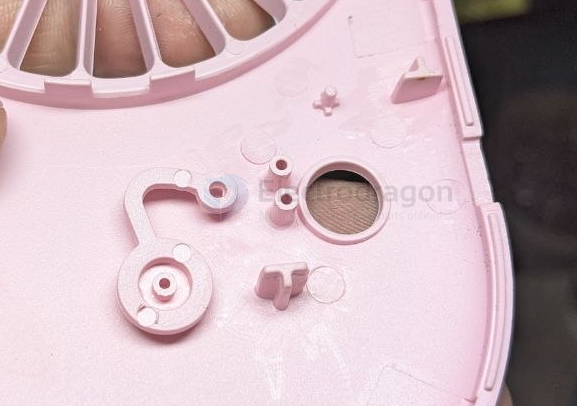
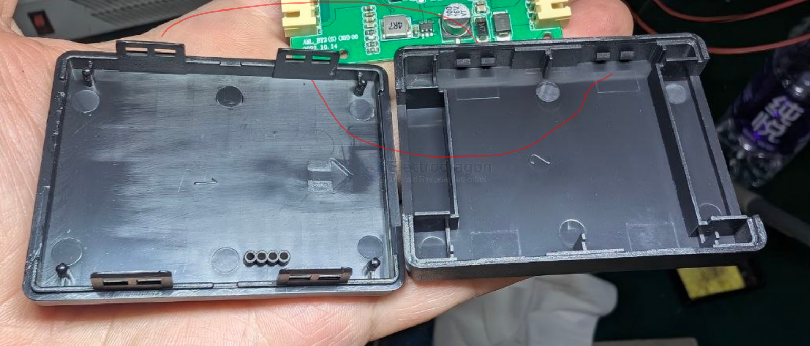
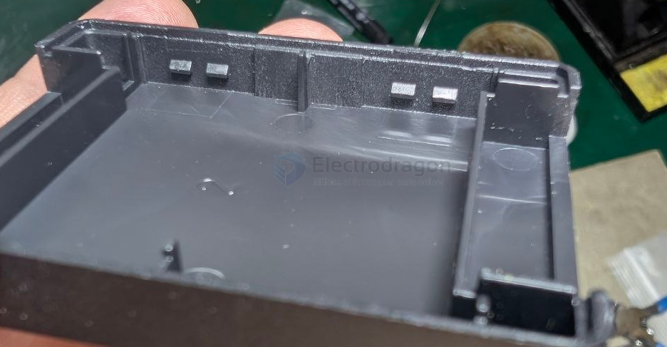
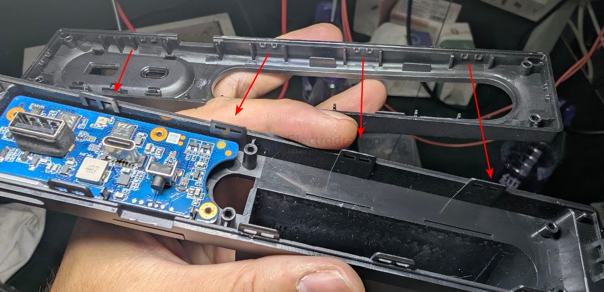

# case-plastic-dat

- [[case-plastic-dat]] - [[case-dat]] - [[rays-Ultraviolet-dat]] - [[rays-dat]]

- [[plastic-dat]] - [[fab-3d-print-dat]]

- [[plastic-dat]] - [[plastic-structure-dat]] - [[case-plastic-dat]] - [[case-dat]] - [[fab-3d-print-dat]] - [[injection-molding-dat]] - [[fab-molding-dat]]

- [[hack-dat]] - [[engineering-reverse-dat]]

## case build 

- [[case-plastic-dat]] - [[Wireless-Video-Doorbell-dat]]

case 3 

case 2 

case 1 

- [[USB-hub-dat]] 

## ref 

