# waterproof-case-dat

- [[waterproof-dat]]

- [[waterproof-container-dat]] - [[case-waterproof-dat]] - [[case-dat]]

- [[case-F1-T-dat]] - [[o-ring-dat]] - [[waterproof-container-dat]] - [[case-waterproof-dat]] - [[case-dat]]

## improvement

improve Enclosure rigidity

## o-ring and groove  

- [[o-ring-dat]] 

壳体 O-ring 未压缩的直径是 2.5mm 

壳体的
- 凹槽深度是 3.5mm 
- 凸槽深度是 1.5mm (压进去的)
- 凹槽宽度是 2.0mm 

## build case 

- [[o-ring-dat]]

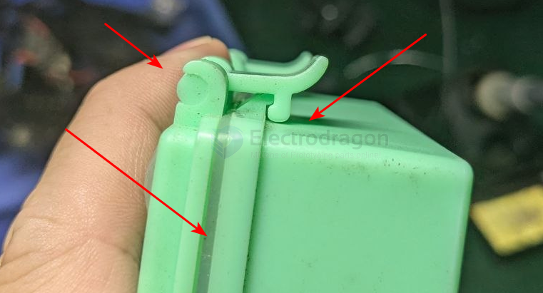

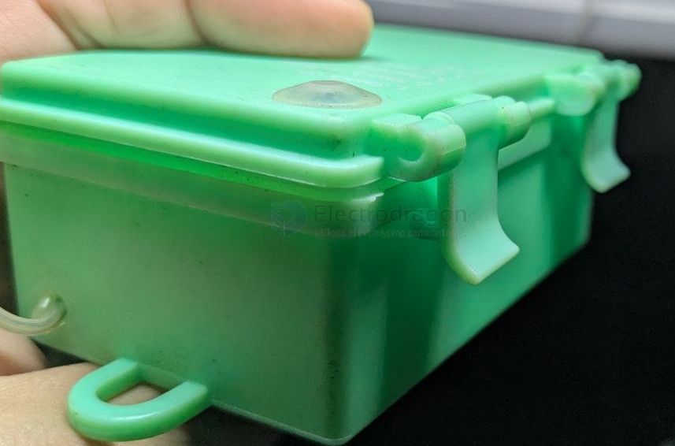

- [[button-dat]]

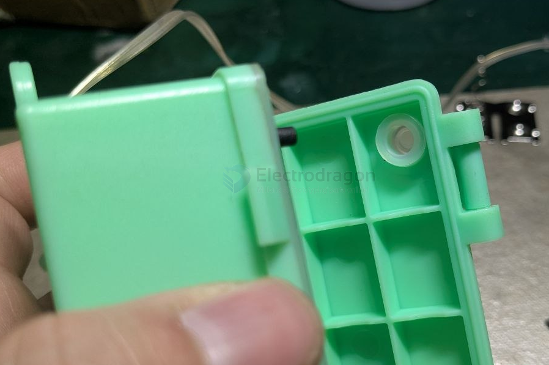

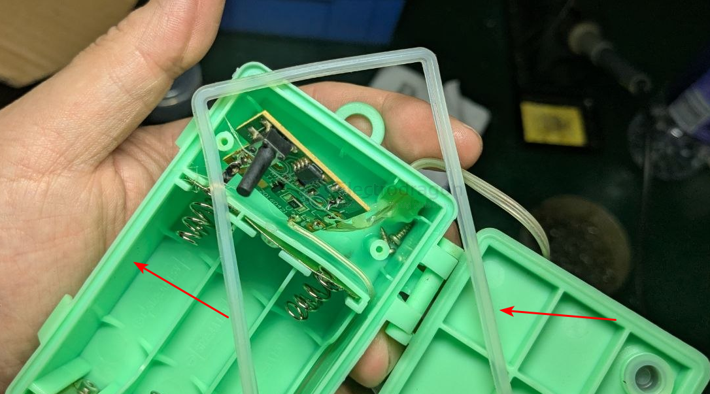

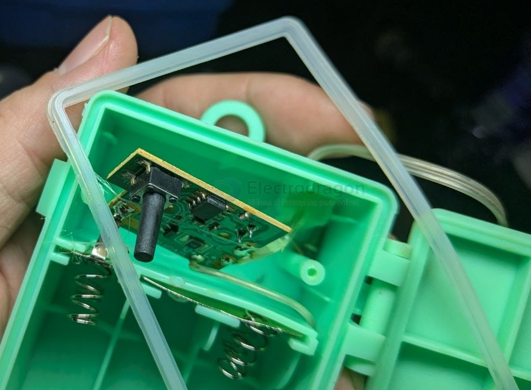

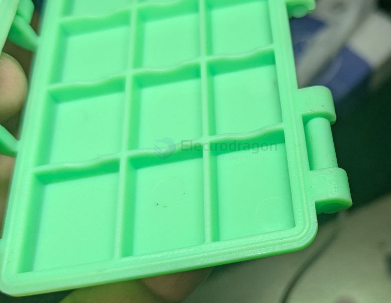

## case purchase list 

### 175x125x75 

140 x 89 x 

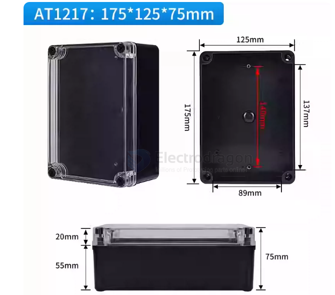

### cases list 

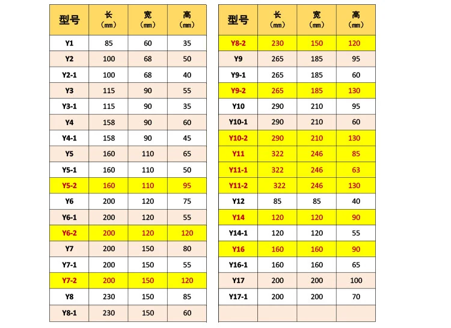

- Y1: 85 x 60 x 35 mm
- Y2-1: 100 x 68 x 40 mm

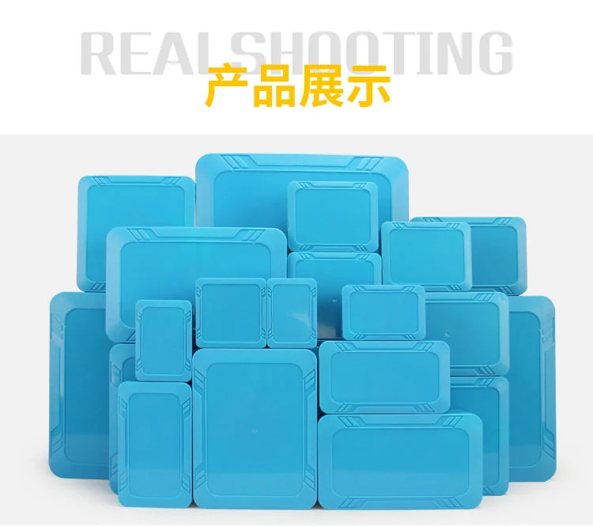

- [[IP68-dat]]

cable case 

inner space == 72 x 49 x 32 mm

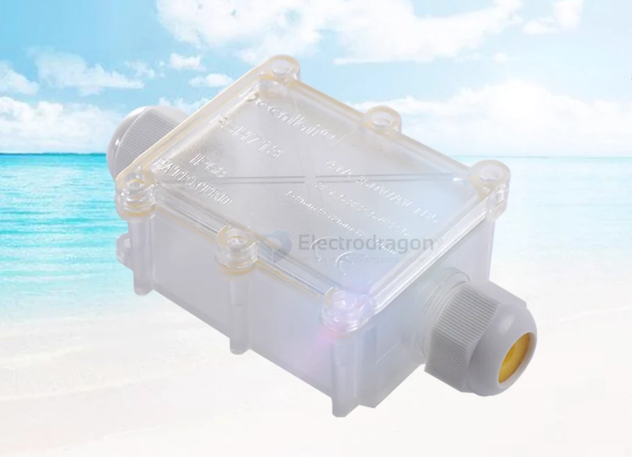

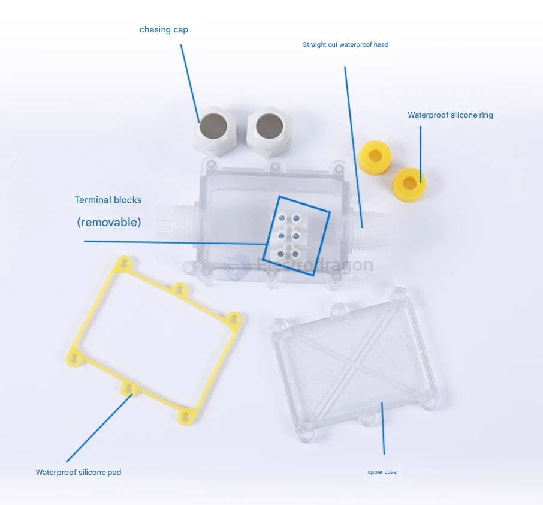

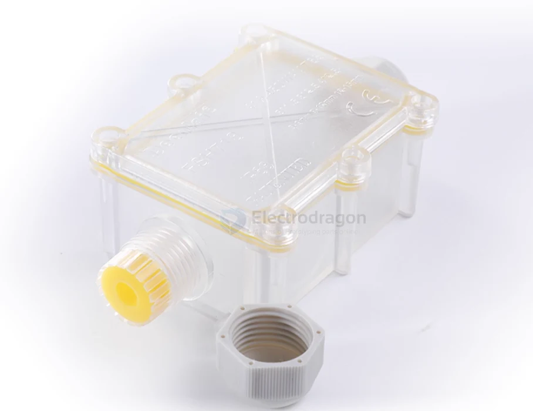

### IP68 case 

semi transparent 

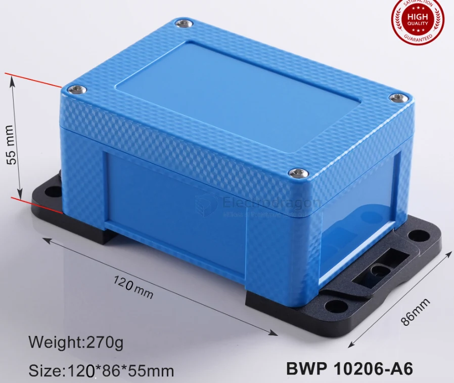

## test demo 

- https://t.me/c/2181060406/17

## ref 

- [[case-dat]]

- [[case-waterproof]] - [[case]]

- [[case]] 