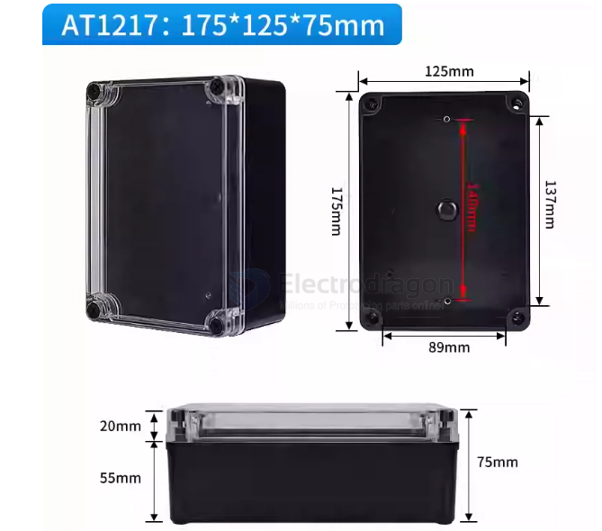
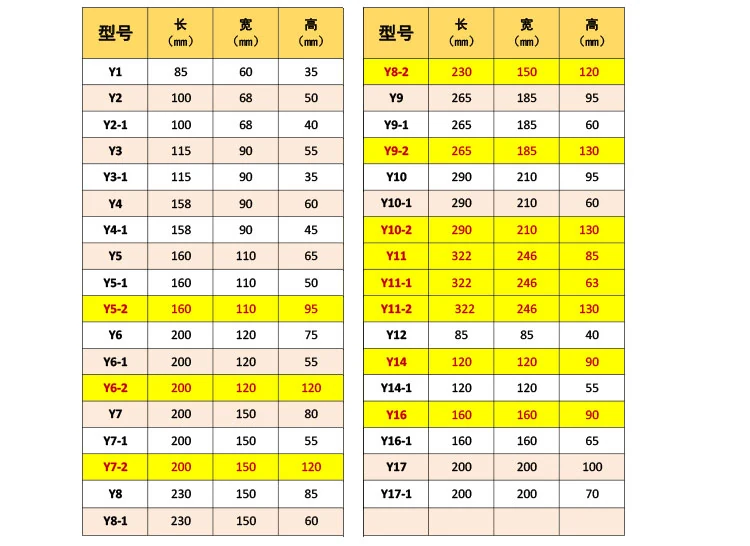
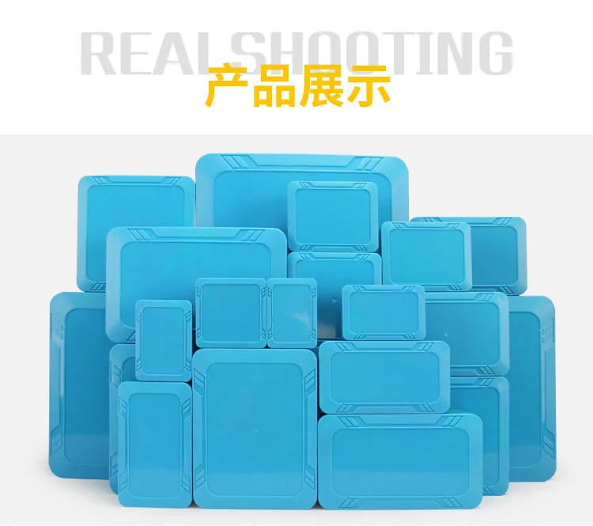
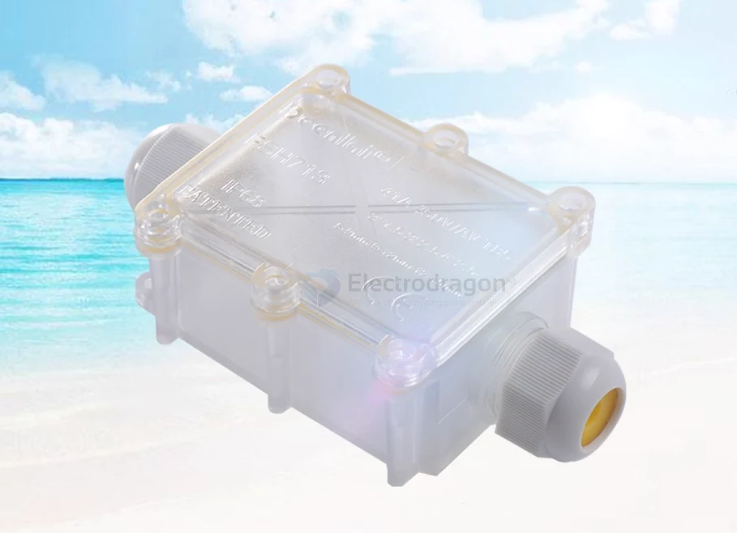
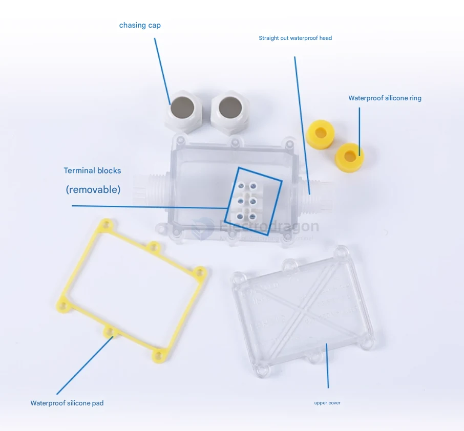
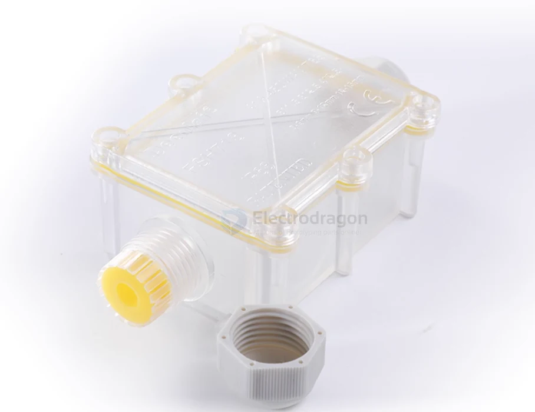
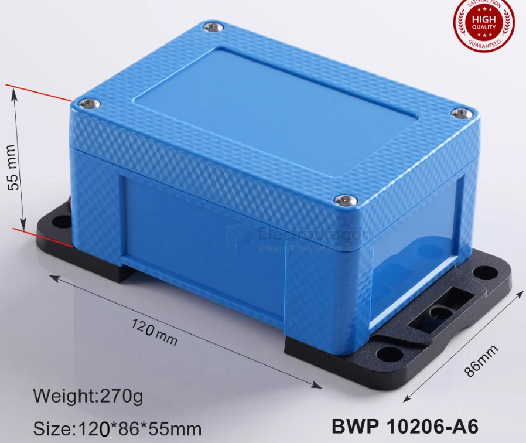

# waterproof-case-dat

- [[waterproof-dat]]

- [[waterproof-container-dat]] - [[case-waterproof-dat]] - [[case-dat]]

## 175x125x75 

140 x 89 x 

## cases list 

- Y1: 85 x 60 x 35 mm
- Y2-1: 100 x 68 x 40 mm

- [[IP68-dat]]

cable case 

inner space == 72 x 49 x 32 mm

## IP68 case 

semi transparent 

## ref 

- [[case-dat]]

- [[case-waterproof]] - [[case]]

- [[case]] 