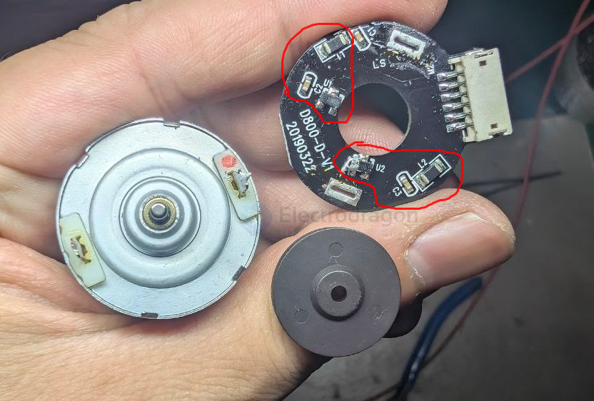
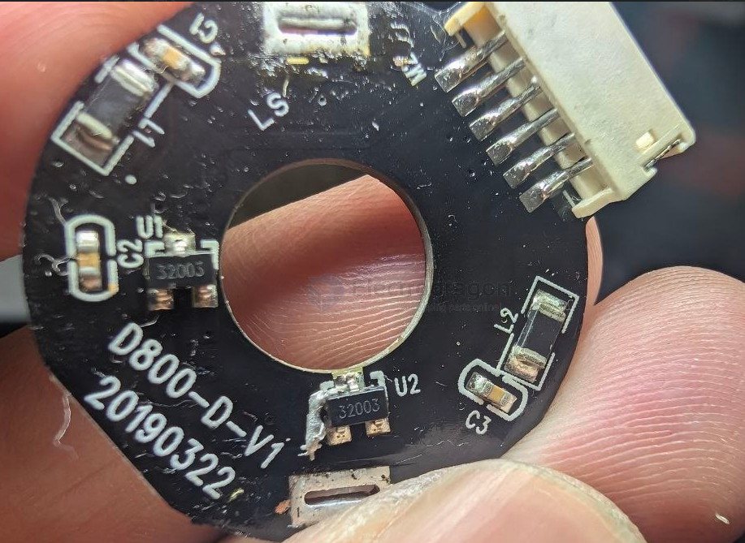

# encoder-motor-dat

- [[motor-dat]] - [[encoder-dat]] - [[encoder-motor-dat]] - [[motor-brushed-dat]]

## Brushed DC Motor with Dual-Channel Hall Encoder Summary

* **Physical Layout:**
* **Magnetic Component:** A multi-pole circular magnet disc (round disk) mounted on the rear extension of the motor shaft, rotating along with the rotor.
* **Encoder PCB:** A circular printed circuit board sandwiched between the motor body and the magnetic disc.
* **Electrical Connections:** The two main motor power terminals are soldered directly to the board, while additional header pins extend outward to supply power and output encoder signals.

* **Circuit Components & Functions:**
* **`U1` (32003, SOT23-3):** Digital hall-effect sensor ICs (two channels, typically providing Phase A and Phase B). They sense the shifting magnetic poles of the rotating disc and convert them into clean square-wave digital pulses.
* **`C1`:** Decoupling/filtering capacitors positioned near the sensors to suppress electrical noise and voltage spikes caused by motor brush commutation.
* **`L1`:** Inductors/beads (or filtering resistors) that form an LC filter circuit with the capacitors to protect sensitive hall sensor logic from high-frequency electromagnetic interference (EMI).

* **Overall Purpose:**
This assembly transforms a standard brushed DC motor into an **incremental encoder-equipped feedback motor**. The multi-pin output provides motor power lines alongside encoder VCC, GND, and quadrature A/B signals, enabling microcontrollers (like Arduino or STM32) to precisely measure **motor speed, rotational direction, and position** for closed-loop control in robotics and smart vehicles.

## build 

## ref 