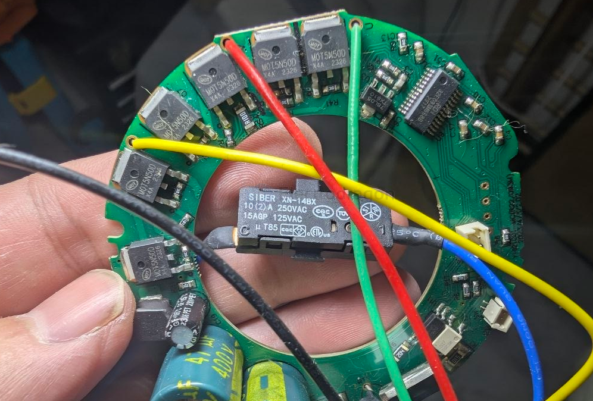

# mosfet-HV-dat

- [[mosfet-HV-dat]] - [[IGBT-dat]] - [[mosfet-dat]]

- [[sytatek-dat]] - [[SA2601-dat]]

## MOT5N50D 500V 

The MOT5N50D is a 500V, 5A N-channel power MOSFET manufactured by MOT Semiconductor using planar technology.

Key Specifications

• Type: N-Channel Power MOSFET
• Drain-Source Voltage (\(V_{DS}\)): 500 V
• Continuous Drain Current (\(I_{D}\)): 5 A
• Power Dissipation (\(P_{D}\)): 85 W
• Package / Case: TO-252 (DPAK) surface-mount package
• Features: Designed for lower conduction and switching losses, high switching speed, and strong dv/dt capability.

- [[sytatek-dat]] - [[SA2601-dat]] - [[LKS620-dat]] - [[LKS-dat]] - [[belling-dat]] - [[mosfet-HV-dat]]

## build 

- [[siber-dat]] - [[switch-slider-dat]] - [[mosfet-HV-dat]]

## ref 

