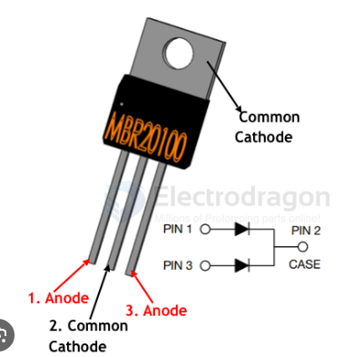
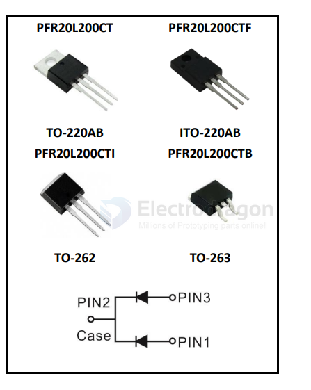
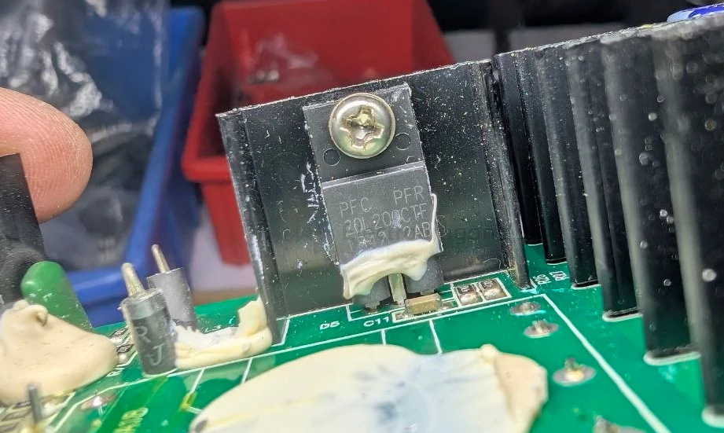
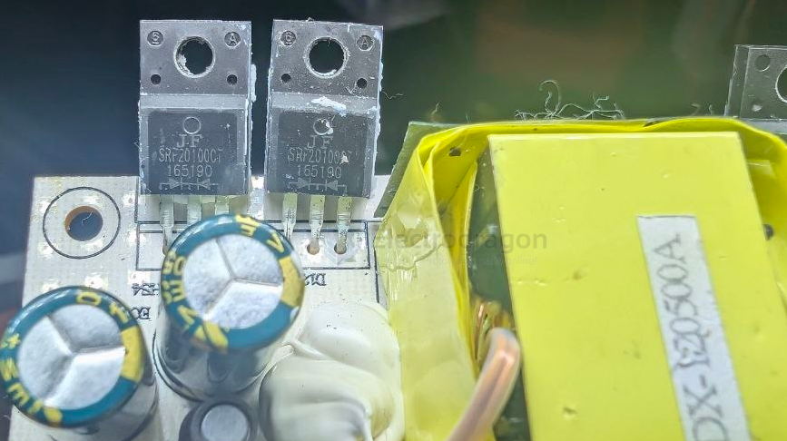
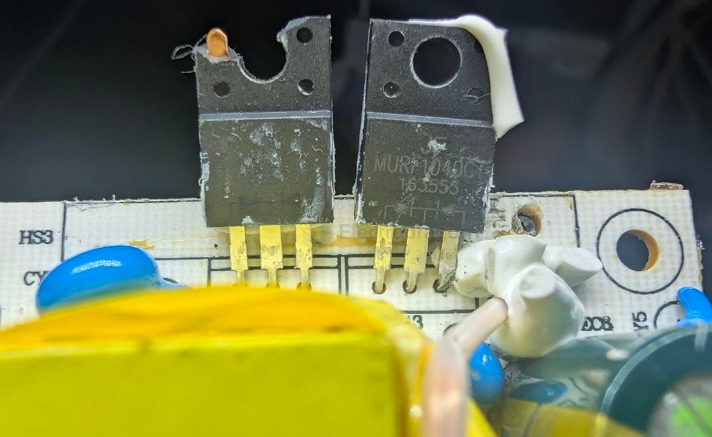
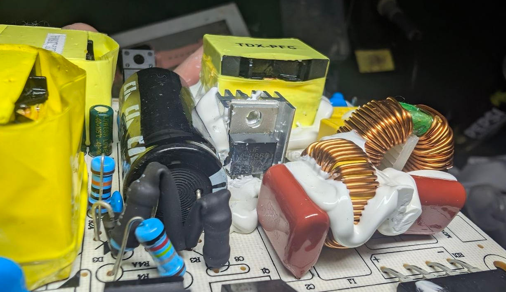

# rectifier-dat

- [[rectifier-dat]] - [[bridge-rectifier-dat]] - [[diode-rectifier-dat]]

- [[rectifier-dat]] - [[diode-rectifier-dat]] 

- [[CR6842-dat]] - [[Center-Tapped-Full-Wave-rectifier-dat]]

- [[lamp-dat]] - [[S4220-dat]] - [[rectifier-dat]] - [[led-driver-dat]]

MicrosemiCatalog Number

- * S4210 - 100V 
- * S4220 - 200V 
- * S4230
- * S4240
- * S4250
- * S4260
- * S4280
- * S42100
- * S42120
- * S42140
- * S42160 - 1600V 

- [[PFC-dat]] 

PFC PFR 20L200CTF - 20A 200V MOS Schottky Rectifier

The `PFR20L200CTF` (commonly searched as PFC FPR 20L200CTF) is a 20A, 200V MOS Schottky rectifier manufactured by PFC Device Corp. It features an ultra-low forward voltage drop and comes in an insulated plastic package

## use 

- [[THX208-dat]] - [[transformer-dat]] - [[rectifier-dat]] == MB6F

## build 

KBP210 

The KBP210 Bridge Rectifier is a single-phase, 2-ampere, 1000-volt silicon bridge rectifier diode used to convert alternating current (AC) into direct current (DC).

- [[rectifier-dat]] - MBR2045CT - [[load-dat]]

- [[ACDC-dat]] - `MURF1040CT` - `JF SRP20100CT`

`JF SRP20100CT`

The part marking JF SRP20100CT identifies a 20A, 100V Dual Common-Cathode Schottky Barrier Rectifier diode.

## voltage high rectifier

- [[mosfet-dat]] - [[voltage-high-dat]]

`MURF1040CT`

The MURF1040CT is an ultrafast/fast recovery dual/common-anode rectifier diode rated typically for 10 Amperes and 400 Volts, housed in an insulated package like ITO-220AB (or TO-220F).

Key Specifications

• Type: Ultrafast Recovery Rectifier (Common Anode / Dual Diode)
• Forward Current (\(I_{F}\)): 10A
• Reverse Voltage (\(V_{R}\)): 400V
• Package Type: ITO-220AB / TO-220F (Insulated Through-Hole)
• Recovery Time: Ultrafast (approx. 35ns range depending on the specific manufacturer)
• Common Manufacturers: Xinnuo Electronics, Goodwork, Thinki Semiconductor, Micro Commercial Components, and SLKORMICRO.

- [[ACDC-dat]] - [[voltage-high-dat]] - [[rectifier-dat]]

The `MUR860` (often stamped with a manufacturer or date/batch code like JF on the casing) is an ultrafast recovery power rectifier diode rated at 600 V and 8 A. It is widely used as a freewheeling, clamping, or output rectifying diode in switching power supplies, inverters, and DC-to-DC converters.

## voltage low rectifier 

The `MBR2045FCT` is a dual Schottky barrier rectifier diode configured with a common cathode.

Key Specifications

• Type: Schottky rectifying diode array (dual / common cathode)
• Max Repetitive Peak Reverse Voltage (\(V_{RRM}\)): 45 V
• Average Forward Current (\(I_{F}\)): 20 A total (10 A per diode leg)
• Package Type: TO-220F / ITO-220AB (insulated / isolated tab package)
• Features: Low power loss, high efficiency, guard ring for transient protection, and high current capability.
• Common Applications: Low-voltage, high-frequency inverters, free-wheeling diodes, and polarity protection circuits.

## MBR 

- [[acdc-led-driver-dat]] 

The `MBR10100FCT` is a 10A, 100V dual common-cathode Schottky barrier rectifier housed in an isolated ITO-220AB (TO-220F) package. 

The "`OCENME`" prefix refers to a specific OEM or distributor branding for this standard electronic component, which is widely manufactured by companies like Micro Commercial Components (MCC) and Yangjie Technology.

## ref 

