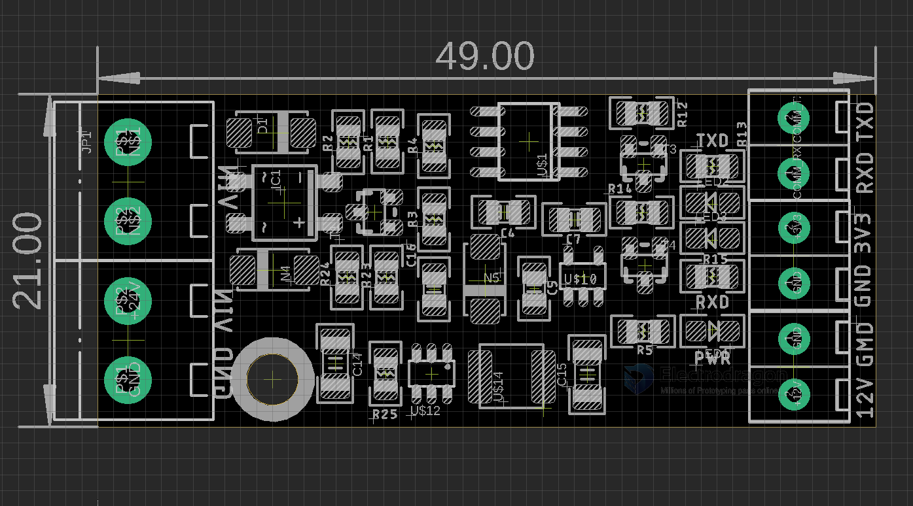
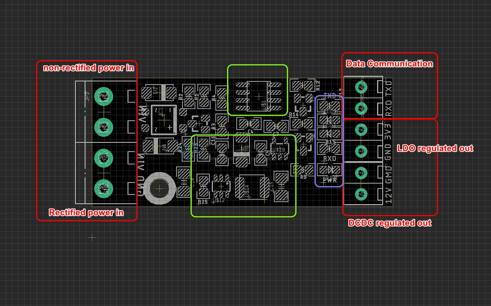

# ITF1009-dat

- [[powerbus-dat]] - [[PB331-dat]] - [[serial-dat]] - [[ITF1009-dat]]

Based on powerbus slave chip PB331.

## dimension 

## Function map 

- left top terminal - no direction power input 
- left bottom terminal - 24V - GND
- right top terminal - serial input and output 
- right middle terminal - 3.3V - GND on board regulator output 
- right bottom terminal - 12V - GND on board DCDC switcher output  

- based on option 401: [[dcdc-dat]] 

- based on option 231: [[LDO-dat]]

## tech 

- [[SY8401-dat]] - [[silergy-dat]] - [[dcdc-down-dat]] - [[ITF1009-dat]]

- [[LDO-dat]] - [[ME6211-dat]] - [[microne-dat]]

## ref 

- [[powerbus-dat]]

- [[ITF1009]]