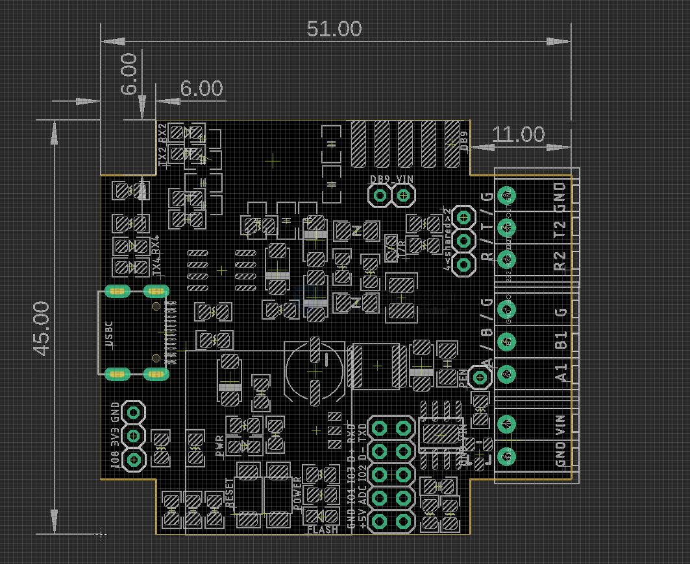
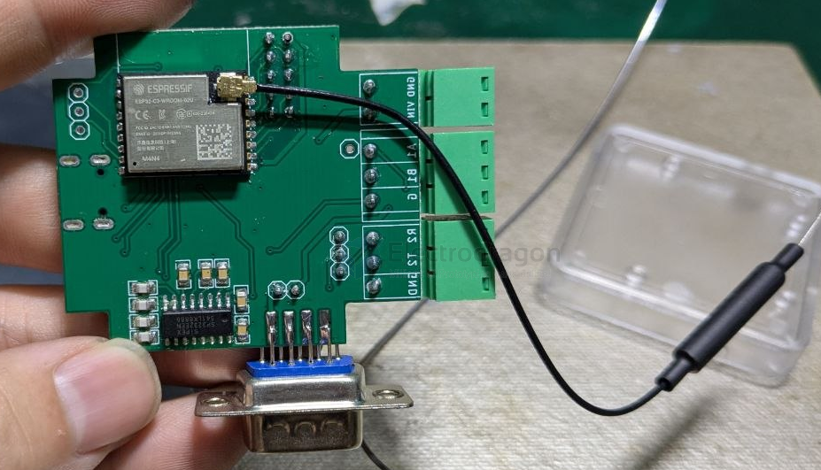
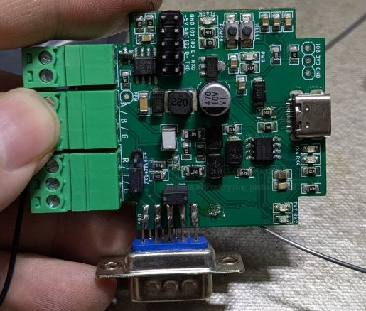
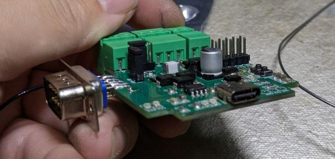
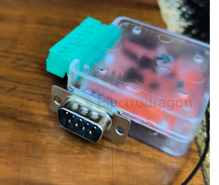

# NWI1255-dat

## Info

[product url - ESP2RS ESP32-C3 RS-485 RS-232 Data Logger V1 w/case](https://www.electrodragon.com/product/esp2rs-esp32-c3-rs-485-rs-232-data-logger-v1-w-case/)

### Board Map, Dimension, Pins, chip info, Use Guide, Setup Jumper, etc.

### Updates version compare to [[NWI1254-dat]]: 

- [[CONN-USB-Type-C-dat]] instead of micro USB
- DB9 connector pre-soldered - [[DB9-dat]] - [[CONN-dat]]
- [[ESP32-C3-dat]] external antenna version 
- pre-added jumper 

## Applications, category, tags, etc. 

## Demo Code and Video

### USB 

通用串行总线设备

USB JTAG/serial debug unit

端口(COM和 LPT)

USB 串行设备(COM78)

## ref 

- [[NWI1255]] - [[NWI1254]]

- [[discount-dat]] 

- legacy wiki page 

- [[NWI1255-fab]] 