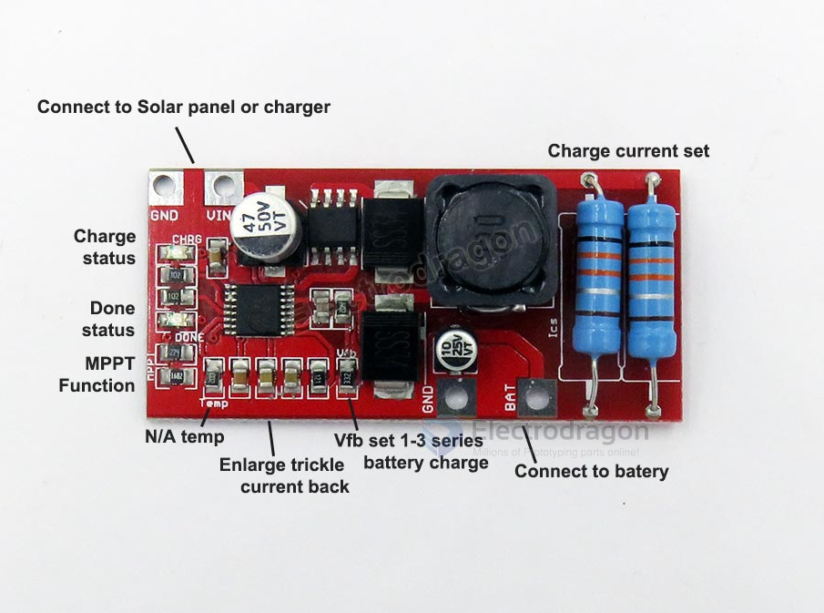
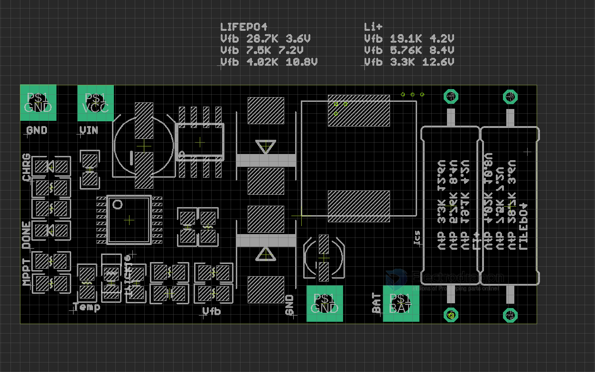

# OPM1146-dat

legacy wiki page - https://www.electrodragon.com/w/Battery_Charge

[Lithium or LiLiFePO4 Battery Charger, Support 1-3 Series](https://www.electrodragon.com/product/1-3-series-lithium-lilifepo4-battery-charger/)

## Features 

## Resistor divider for feedback:

- Please notice default **Rvfb is 3.3K = 3x** == 3S lithium battery 
- Change Vfb resistor to set this stop voltage
- All the rest SMD resistors are included in the package.
- Supply VCC should be +2V > Vbat

Notice the import solar panel voltage is set to 15V, based on [[MPPT-dat]]

## temperature 

== N/A temp == 10K NTC fixed: 

A 10kΩ NTC (negative temperature coefficient) thermistor can be connected from the TEMP pin to ground for battery temperature qualification. The charge cycle is suspended if the battery’s temperature is outside of the acceptable range. 

## Board Functions 

Setup for V_fb

| Charge Target   | Series | Regulation Voltage | Rv_fb voltage feedback resistor selection |
| --------------- | ------ | ------------------ | ----------------------------------------- |
| LIFEPO4         | 1x     | 3.6V               | 28.7K                                     |
| LIFEPO4         | 2x     | 7.2V               | 7.5K                                      |
| LIFEPO4         | 3x     | 10.8V              | 4.02K                                     |
| Lithium ion Li+ | 1x     | 4.2V               | 19.1K                                     |
| Lithium ion Li+ | 2x     | 8.4V               | 5.76K                                     |
| Lithium ion Li+ | 3x     | 12.6V              | 3.3K                                      |

- [[battery-li-LFP-dat]] - [[battery-li-dat]]

## Demo 

- A rough testing here, more tutorial can google or please email us.
- https://twitter.com/electro_phoenix/status/988636991171452930

## ref 

- [[CN3722-dat]] - [[battery-dat]]

- [[mosfet-dat]]

- [[MPPT-dat]]

- [[CN3722]] - [[consonance]]