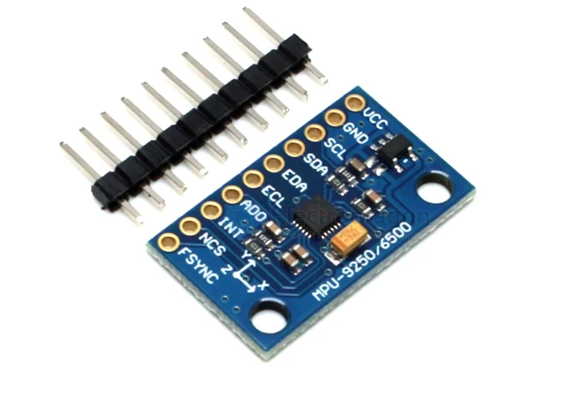

# SMO1075-dat

- [[MPU9250-dat]] - [[MPU-9255-dat]] - [[MPU9255-dat]] - [[MPU6500-dat]] - [[IMU-dat]] - [[invensense-dat]]

- [[IMU-dat]] - [[3-axis-gyroscope-dat]] - [[3-axis-Accelerometer-dat]] - [[3-Axis-Magnetic-dat]] - [[sensor-motion-dat]]

## Info

[product url - 9DOF MPU-9255 accelerometer Magnetometer Gyroscope Breakout](https://www.electrodragon.com/product/9dof-mpu-9255-3d-acceleromagnetogyroscope-breakout/)

- 使用芯片：MPU-9250
- 供电电源：3-5v（内部低压差稳压）
- 通信方式：标准IIC通信协议
- 芯片内置16bit AD转换器，16位数据输出（磁场13位）
- 陀螺仪范围：±250 500 1000 2000°/s
- 加速度范围：±2±4±8±16g
- 磁场范围：±1200uT
- 采用沉金PCB,机器焊接工艺保证质量
- 引脚间距：2.54mm

### Board Map, Dimension, Pins, chip info, Use Guide, Setup Jumper, etc.

## Applications, category, tags, etc. 

## Demo Code and Video

## ref 

- [[SMO1075]] 

- legacy wiki page 

https://www.electrodragon.com/w/MPU
