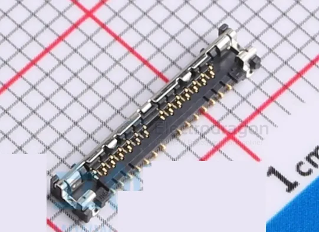
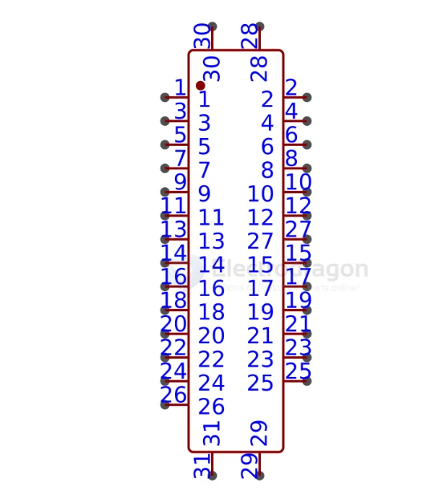
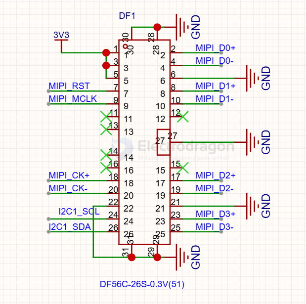

# conn-DF56-dat

0.6mm == - [[conn-DF56c-dat]] - [[conn-dat]] - [[conn-BTB-dat]]

DF56C-26S-0.3V(51)

## use 

- [[SSC338-dat]] - [[conn-DF56-dat]] - [[IMX415-dat]]

- [[conn-DF56-dat]] - [[openIPC-dat]] - [[SSC338-dat]]

## interface 

- [[conn-DF56-dat]] - [[sensor-camera-dat]] - [[MIPI-dat]]

- [[conn-DF56-dat]] - [[openIPC-dat]] - [[SSC338-dat]] - [[camera-IP-dat]]

注意核对封装13与14、 26引脚位置同侧。

DJI副厂同轴线中间6脚11-16不通！！！固不使用

## ref 