# CONN-FPC-dat 

- [[CONN-FPC-dat]] - [[FPC-dat]] - [[conn-dat]]

## types 

- [[conn-FPC-vertical-dat]] - [[IVG-G4H-dat]] == 立贴错位

最主流的三款通用 Pitch   

- `0.5mm（行业黄金标准）`：消费电子里最普及的规格。它在布线密度、焊接良率和成本之间最均衡，常见于显示屏（LCD/OLED）、触摸屏、树莓派/开发板摄像头模组，常见 Pin 数为 4～80 Pin。   
- `1.0mm（稳健/大电流首选）`：机械强度高、手工插拔容错率大，单针载流能力通常在 0.5A～1.0A 左右。多用于家电控制板、工控设备或需要走一定供电电流的场景。   
- `0.3mm（高密度超紧凑）`：主要用于空间极其受限的设备，比如智能手机内部排线、智能手表等穿戴设备及微型摄像头模组，高度通常不到 1mm。

common flat 

- 下接抽屉
- 上接抽屉
- 下接翻盖

## apps 

- [[CONN-FPC-dat]] - [[Wifi-SDIO-dat]]

- [[CONN-FPC-dat]] - [[display-app-dat]]

- [[sensor-camera-sensor-dat]] - [[cable-FPC-dat]] - [[conn-FPC-dat]] - [[Wireless-Video-Doorbell-dat]]

## use 

- [[MIPI-dat]] - [[conn-FPC-dat]]

pair 

- [[IMX415-dat]] - [[SSC338-dat]] - [[RTL8812-dat]] - [[PCB-design-complex-dat]] - [[IMX307-dat]]

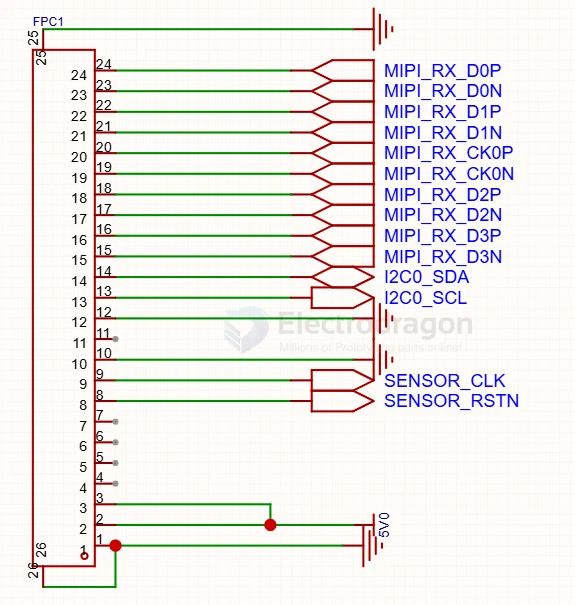

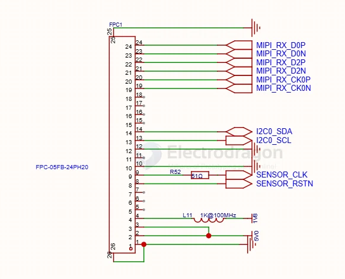

## Info 

FFC usually means “Flat Flex Cable”

- add [[test-point-dat]] for debugging 

- common pitch 0.5 mm

overview 

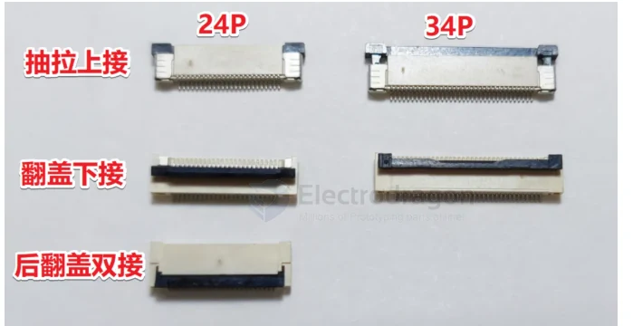

- common pitch 1.0 mm

## type 

FPC down flip 

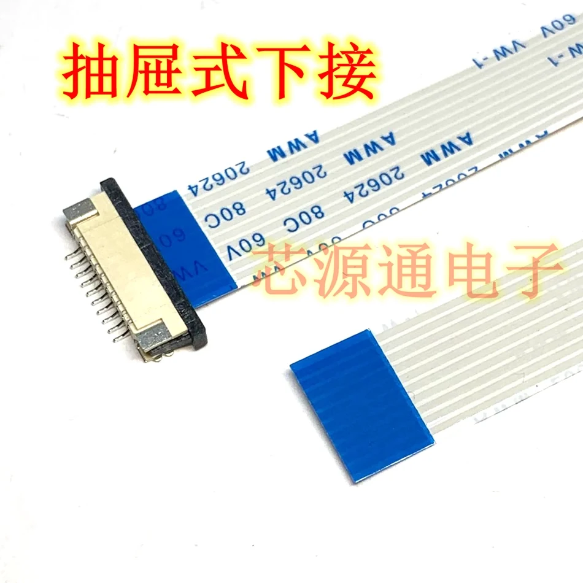

FPC upper flip 

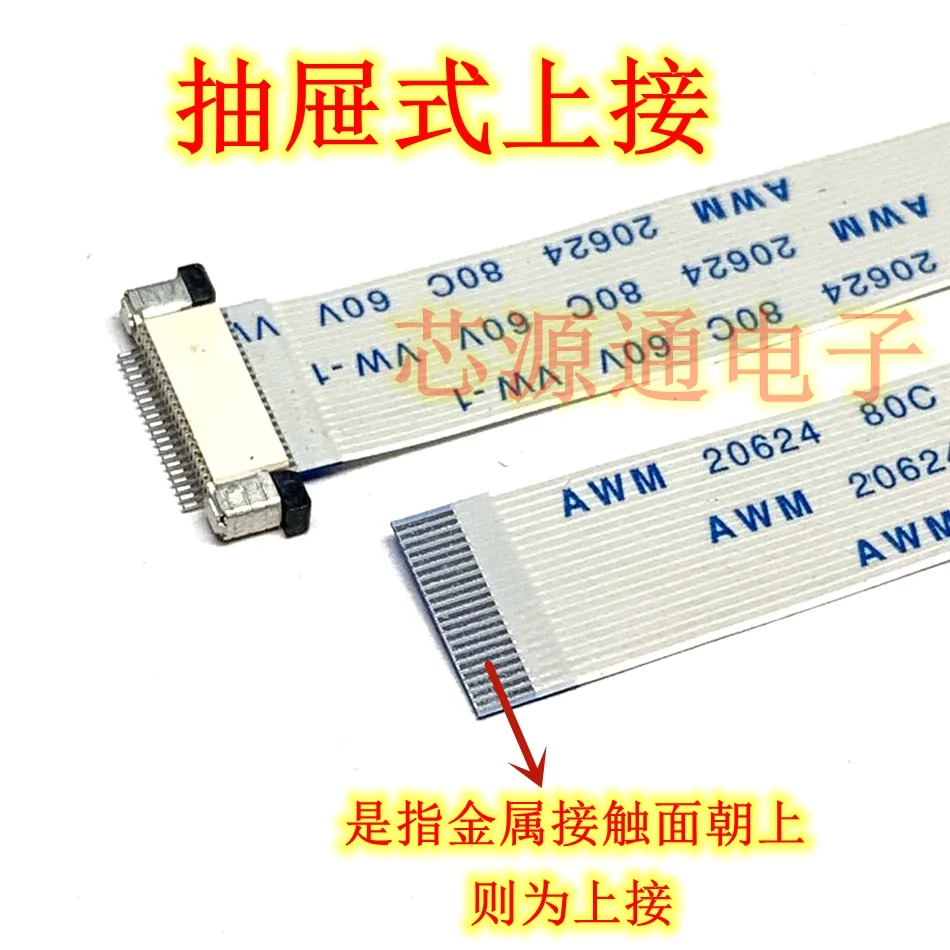

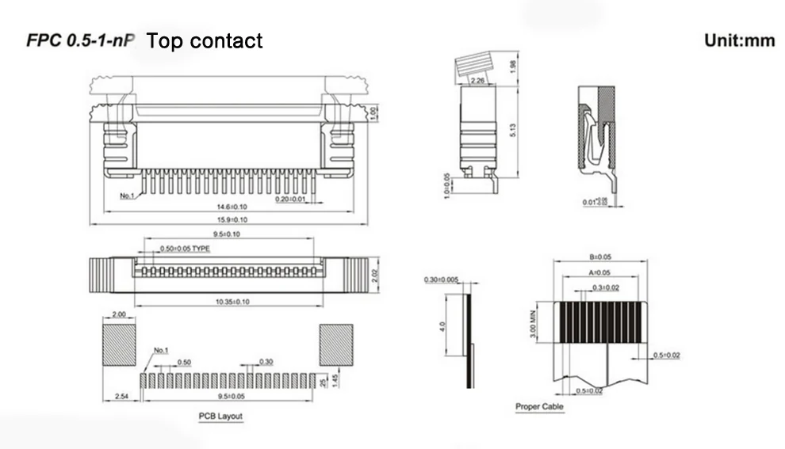

## footprint 

THD0510－xxCL－GF == datasheet [[THD0510-xxCL-GF.pdf]]

- FPC-SMD_9P-P0.50_THD0510-09CL-GF
- FPC-SMD_5P-P0.50_THD0510-05CL-GF == 间距:0.5mm P数:5P 翻盖式 下接

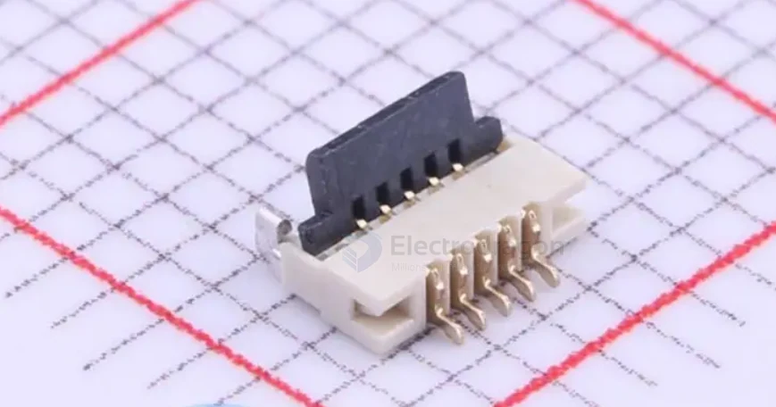

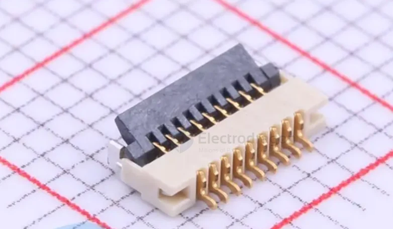

## dimension 

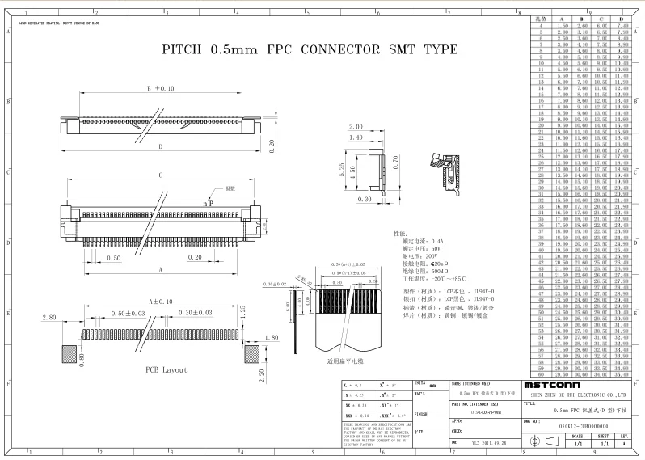

## soldering 

Use low-temperature solder [[solder-paste-dat]] to tin the pads first, then clean the pads with board cleaning solution, brush on BGA soldering flux, and finally use a hot plate. The result is almost as good as factory production.

## manu code 

- AFC01-S06FCA-00 == 下接
- AFC01-S18FCA-00 == 下接
- THD0510-05CL-GF == 上接
- THD0510-09CL-GF == 上接

- 34P 上接 

## stiffener

For ordering at JLCPCB, define a seperate layer for your stiffeners, like I did here:

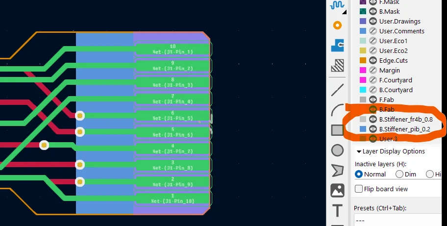

This design actually has an FR4 and a polyimide stiffener, so two layers.

## issue 

- 16P pin 

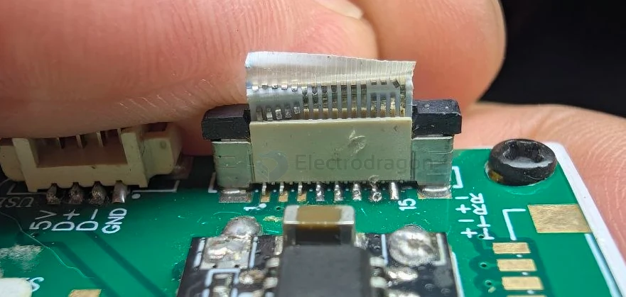

## ref 

- [[soldering-dat]]

- [[FPC-fab-dat]]

- [[FPC]] - [[FPC-socket]] - [[FPC-pin]]