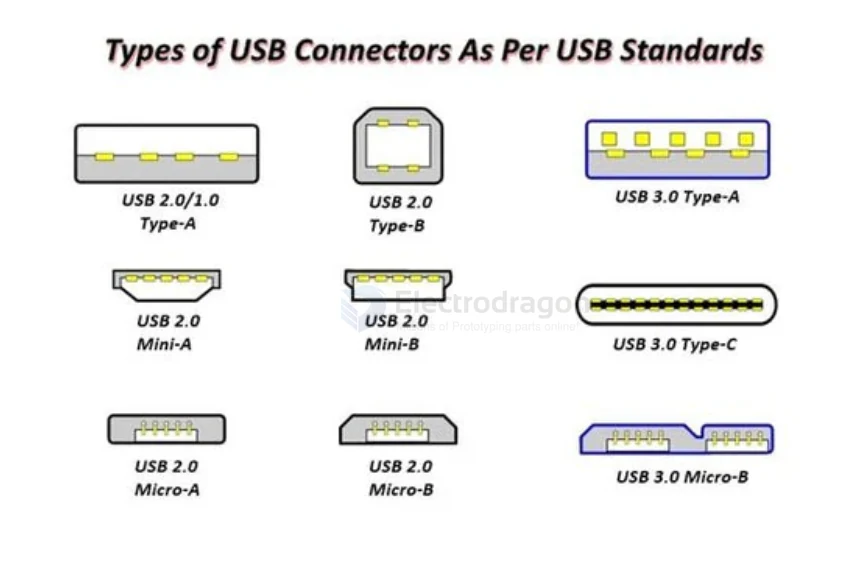
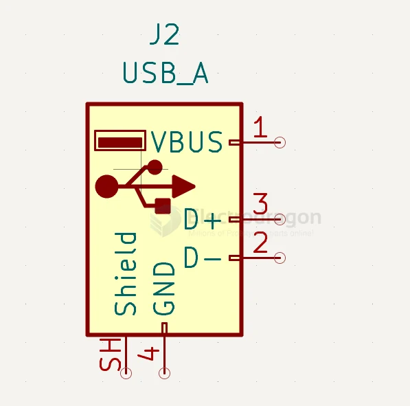
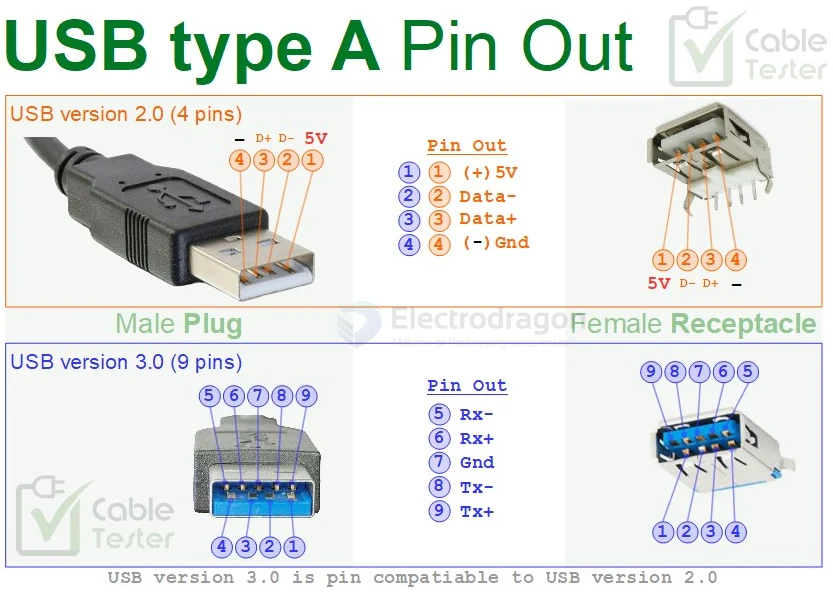
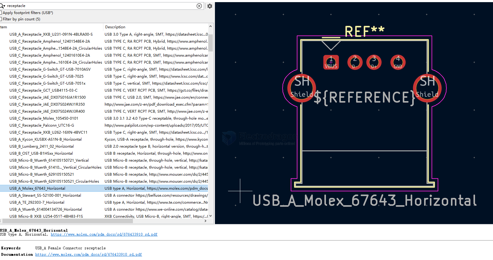
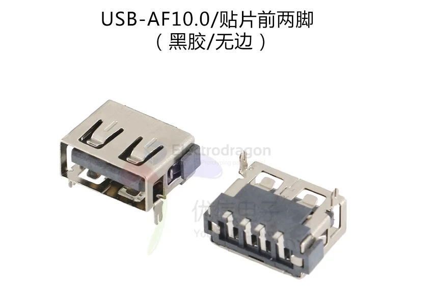
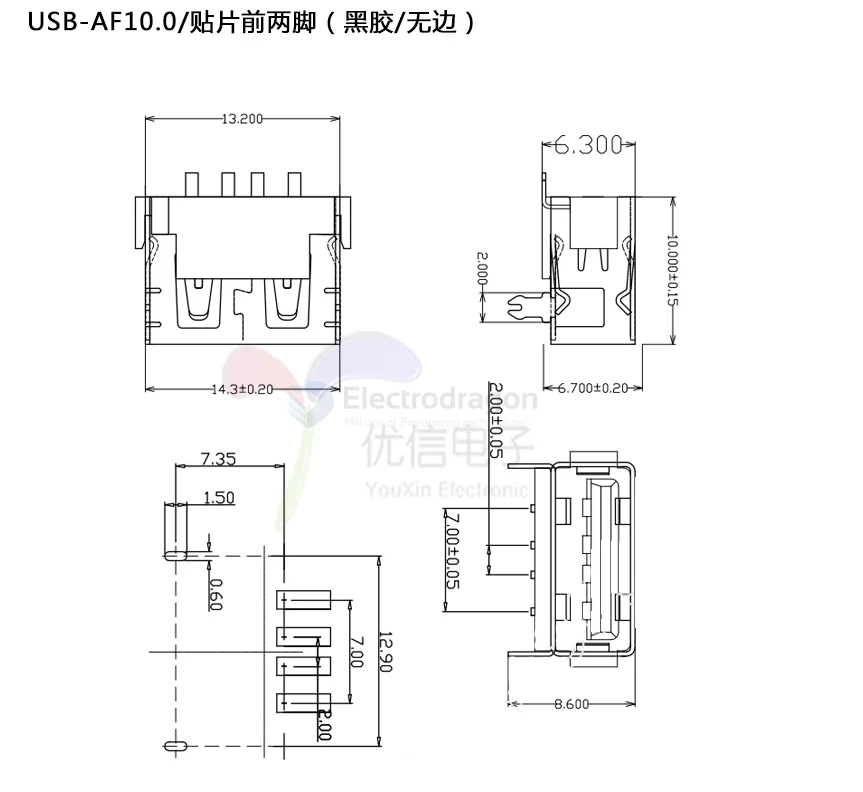
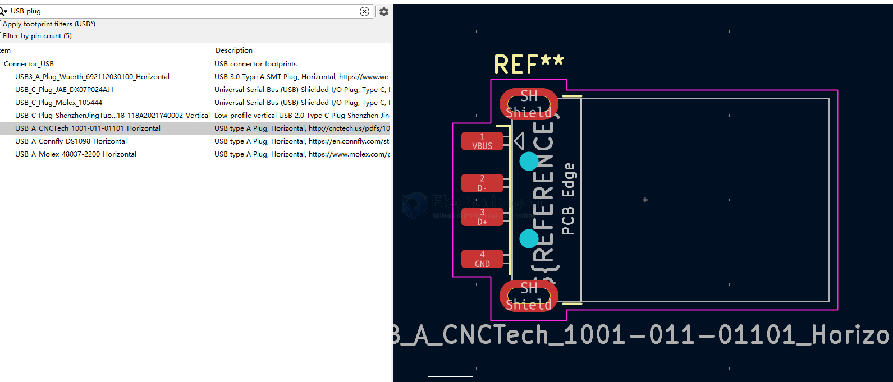
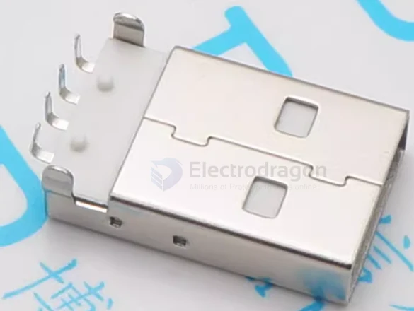
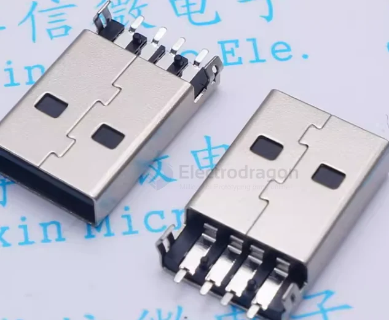

# CONN-USB-A-dat

- [[CONN-USB-A-dat]] - [[USB-HOST-dat]] - [[USB-device-dat]] - [[CONN-USB-dat]]

- [[CONN-USB-receptacle-dat]] - [[CONN-USB-plug-dat]] - [[CONN-USB-A-dat]] - [[kicad-footprint-dat]]

- [[CH554-dat]] - [[CH55x-dat]]

## in USB-HUB

- [[USB-hub-dat]] 

### USB-A 的电路设计与芯片成本极低
USB-A 只有 9 个引脚（USB 3.0 规格），方向固定（单面插），不需要做正反盲插切换电路。

USB-C 有 24 个引脚，如果一个 Hub 要提供 3 个全功能 USB-C 下行口，每个接口都需要搭配独立的 CC 逻辑检测芯片、高速数据多路复用器（MUX 开关芯片）和过流保护芯片，用来判断插头正反面以及协商供电角色。这会让 Hub 的 BOM 硬件成本、PCB 布线面积和发热量成倍增加。

### 避免供电与主从角色（DRP）逻辑冲突
USB-A 的物理角色是死锁的： 法律与 USB-IF 规范规定，USB-A 母座永远只能作为供电方（Source / Host 下行口），只能向外输出 5V 电力，绝对不会反向吸电，也不会出现“两个主机对插烧毁设备”的问题。

USB-C 是双向角色（DRP）： 如果 Hub 下行口做成 USB-C，一旦用户把充电器插错进数据口，或者两台带电设备互连，就必须依赖复杂的 PD 协议握手来防止烧毁电路；而做成 USB-A 可以从物理形态上直接杜绝“插错充电头”的误操作。

### USB 3.0（5Gbps）带宽用 USB-A 已经完全跑满
对于 USB 3.0 / USB 3.1 Gen 1（5Gbps）速率而言，9 针的 USB-A 接口（里面有独立的 1 对 TX 和 1 对 RX 高速差分线）已经能 100% 跑满 5Gbps 带宽，不需要 USB-C 那另外一套冗余的镜像高速引脚。

(注：近两年只有少数定位高端、价格在两三百元以上的“全 C 口集线器”或雷电拓展坞，才会在下行口配备多个 USB-C，并且即便如此，那些下行 USB-C 口通常也只支持数据传输、不支持视频输出和 PD 反向充电。)

## type-A 

symbol == USB_A == USB Type A connector

## type-A Female == receptacle

VBUS | D- | D+ | GND

## type-A male == plug 

VBUS | D- | D+ | GND

board sinked 

## ref 

- [[CONN-USB]] - [[USB-A]] - [[CONN]]
