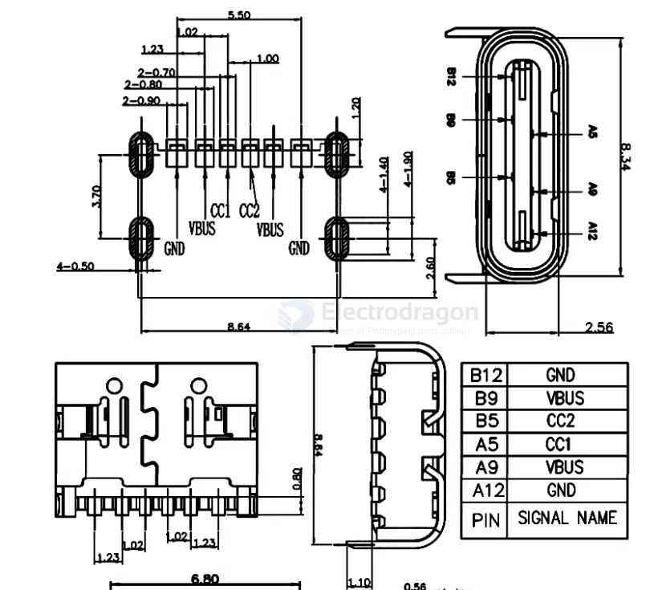
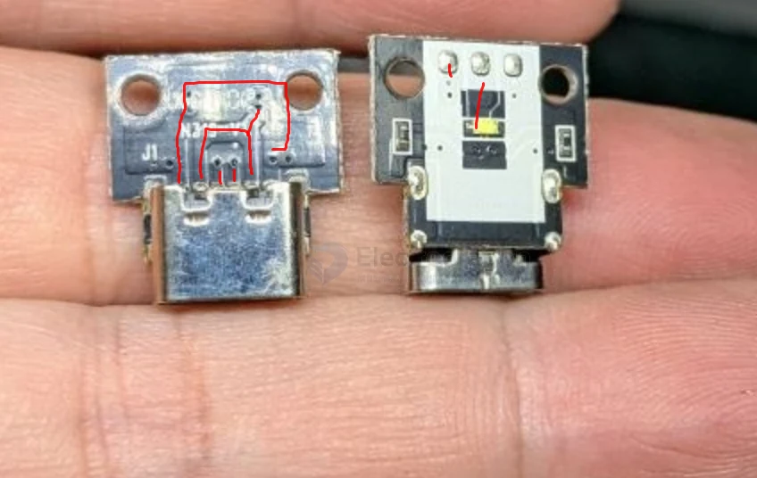
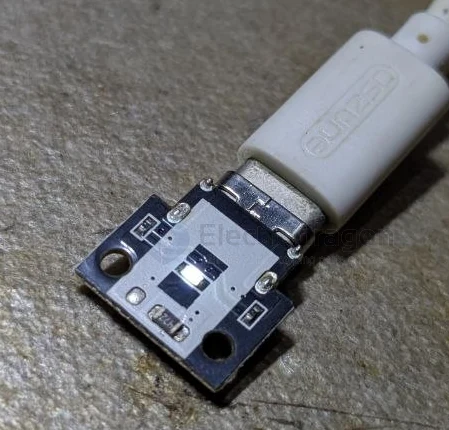

# CONN-USB-type-c-female-6P-dat

### type-C 6 pins 

== no D+ / D- data pins 

| PIN | SIGNAL NAME |
| --- | ----------- |
| B12 | GND         |
| B9  | VBUS        |
| B5  | CC2         |
| A5  | CC1         |
| A9  | VBUS        |
| A12 | GND         |

## build 

## ref 

