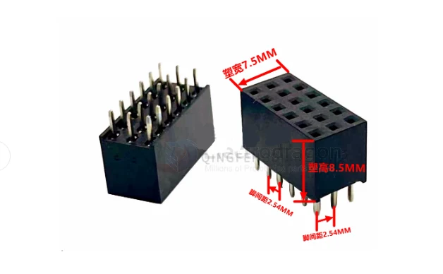

# CONN-pin-header-female-dat

- [[CONN-dat]] - [[pitch-dat]] - [[conn-pin-header-dat]] - [[conn-pin-header-female-dat]] - [[conn-pin-header-SMD-dat]]

## ROW =3

- 3 * 2P
- 3 * 3P
- 3 * 4P
- 3 * 5P
- 3 * 6P
- 3 * 7P
- 3 * 8P
- 3 * 9P
- 3 * 10P
- 3 * 11P
- 3 * 12P
- 3 * 14P
- 3 * 15P
- 3 * 18P
- 3 * 20P
- 3 * 25P
- 3 * 30P
- 3 * 40P

## specs 

common height == 8.5 mm 

height 

- 单排母 - 塑高 - 3.5MM - 环保
- 单排母 - 塑高 - 5.0MM - 环保
- 单排母 - 塑高 - 5.7MM - 环保
- 单排母 - 塑高 - 7.1MM - 环保
- 单排母 - 塑高 - 8.5MM - 环保

- 单排针 - 总长 - 7.5MM - 镀金
- 单排针 - 总长 - 8.5MM - 镀金
- 单排针 - 总长 - 9.5MM - 镀金
- 单排针 - 总长 - 10.5MM - 镀金
- 单排针 - 总长 - 11.5MM - 镀金

## pins 

- 1*2P
- 1*3P
- 1*4P
- 1*5P
- 1*6P
- 1*7P
- 1*8P
- 1*9P
- 1*10P
- 1*11P
- 1*12P
- 1*13P
- 1*14P
- 1*15P
- 1*20P
- 1*30P
- 1*40P

## ref 

- [[conn-pin-header-female]] - [[conn-pin-header]]

- [[conn-pin-header-dat]]
