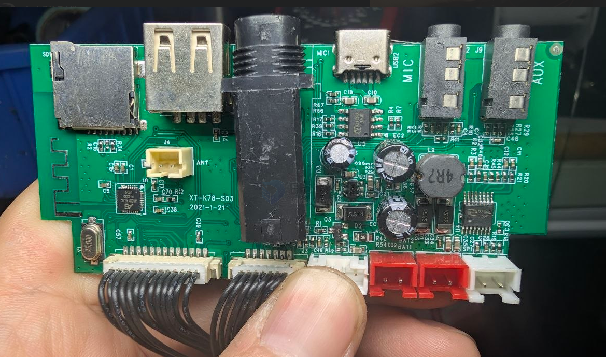
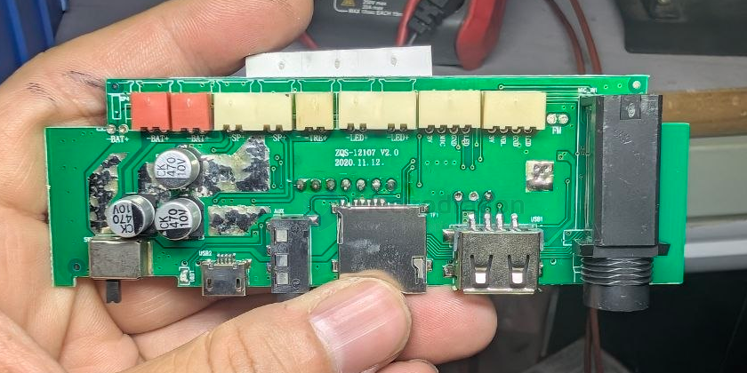
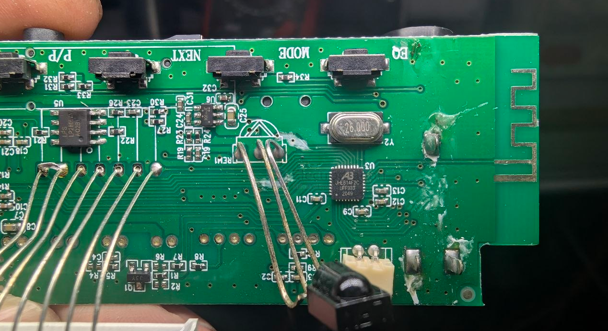
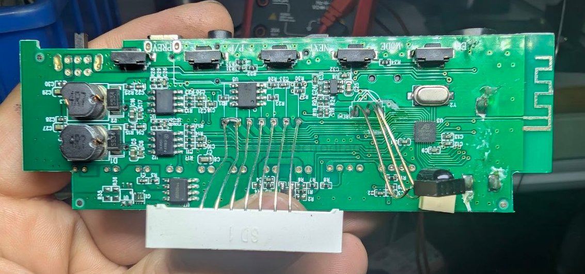
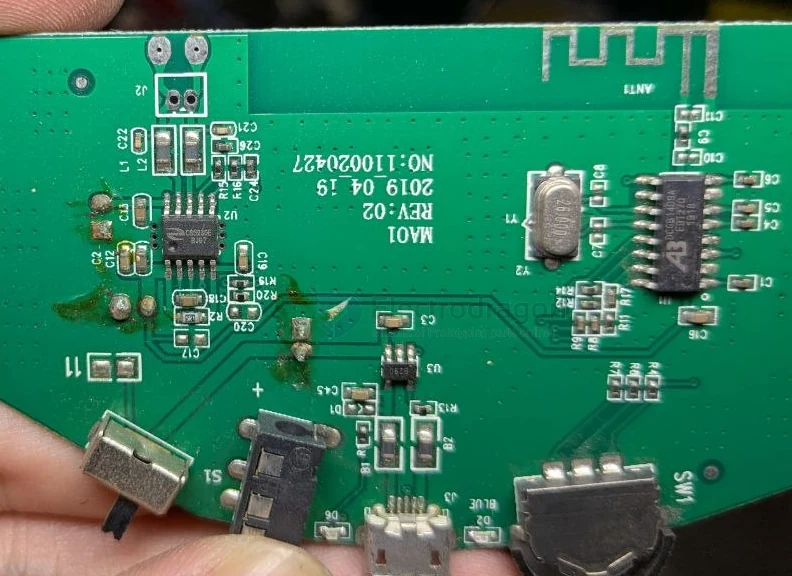
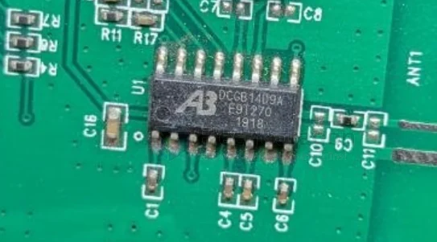

# A3-dat

- [[power-bank-dat]] - [[A3-dat]] 

- [[ismartware-dat]] - [[SW6005-dat]] - [[SW6808-dat]]

- [[A3-DCGB14D9A-dat]]

CHEC14C0B JHEB14F2B JHEB14F2C JAEB14F2C CHEC14C0A A3

The `CHEC14C0B` is an A3 Bluetooth IC / audio receiver chip (often supplied in a QFN surface-mount package) used in small electronic devices and audio systems. It is commonly sold in integrated circuit sets or individual chips alongside companion models like CHEC14C0A, JHEB14F2B, JHEB14F2C, and JAEB14F2C.
Key details:
• Type: Integrated Circuit (IC) / Bluetooth Audio Receiver / Microcontroller component
• Package: SMD / QFN package
• Dissipation Power: ~0.5W

- [[audio-dat]]

## JAEB14F2C 

build 2 

- [[yongfukang-dat]] - [[CS83702-dat]]

- [[HX4004-dat]] - [[TP4056-dat]] - [[dcdc-boost-dat]] - [[battery-charger-1s-dat]]

build 1 

- [[lowpowersemi-dat]] - [[LP28057-dat]] - [[battery-charger-1s-dat]] - [[A3-dat]]

- [[battery-protector-1s-dat]] - [[xysemi-dat]] - [[XB8886-dat]]

- [[HT8691-dat]] - [[HEROIC-dat]] - [[A3-dat]] - [[audio-dat]]

- [[hexin-dat]] - [[HX4004-dat]] - [[A3-dat]]

## DCGB14D9A

The term A3 DCGB14D9A likely refers to a microcontroller or power management chip (SoC) manufactured by JL (Bluetrum Technology), which is commonly found in budget Bluetooth audio devices and wireless earbuds.

## ref 

- [[jieli-dat]]