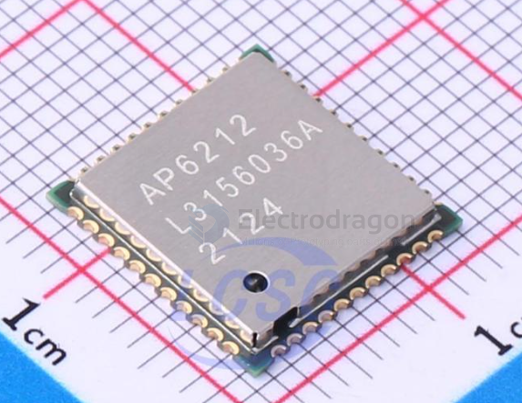

# AMPAK-dat.md

- [[AMPAK-dat]] - [[AP6212-dat]] - [[wifi-sdio-dat]]

## AP6212-dat

The AP6212 - Stamp Type 1T1R-Ampak Technology Inc. is a compact, low-power wireless System-in-Package (SiP) module developed by AMPAK Technology.

Key Specifications

• Manufacturer: AMPAK Technology
• Form Factor / Package: Stamp type / QFN-44 (12 x 12 mm)
• Operating Frequency: 2.4 GHz
• Wi-Fi Standard: IEEE 802.11 b/g/n (Single-stream spatial multiplexing up to 72.2 Mbps)
• Wi-Fi Interface: SDIO (v2.0)
• Bluetooth Standard: Bluetooth (supports up to BT 5.4 / legacy versions like BT 4.0/4.1 depending on revision)
• Bluetooth Interface: UART / I2S / PCM
• Additional Features: Integrated FM Radio Receiver (FM RX)
• Operating Temperature: -30 °C to +85 °C
• Driver & OS Support: Linux, Android, RTOS (commonly used in SBCs like Banana Pi, Khadas, and Armbian-supported boards)

### SCH 

SCH 1 

## ref 

