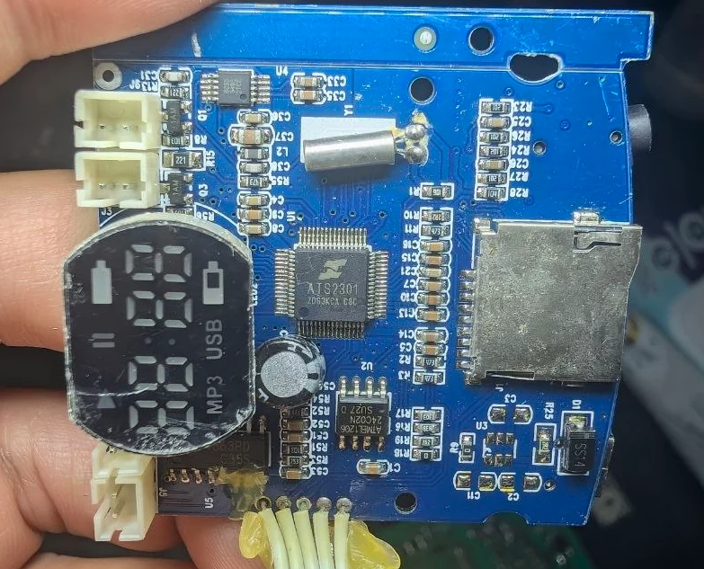
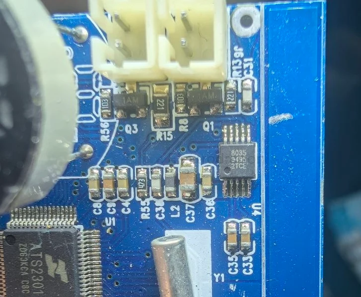

# ATS2301-dat

- [[ATS2301-dat]] - [[Actions-Semi-dat]] - [[MP3-dat]] - [[codec-dat]] - [[audio-dat]]

ATS2301 most commonly refers to an audio playback integrated circuit (IC) by ACTIONS (in a QFP64 package), though it can also match part numbers in thermal management.

ACTIONS ATS2301 Audio IC

- • Package: QFP64, RoHS compliant.
- • Audio Capabilities: Supports MP3, WMA, and WAV playback across 8 kHz–48 kHz sampling rates, with FAT16/FAT32 filesystem support, microSD/USB disk reading, 16 volume levels, and 8 EQ presets.
- • Control & Power: Supports UART serial control, external PA expansion, Li-ion battery operation, and basic calendar functions.
- • Sourcing & Datasheets: Available through electronic component brokers and listings such as Jotrin and ic2ic.com, or via module implementations like the Garan Audio Module.

## build 

- [[QN8035-dat]] - [[ATS2301-dat]] - [[Actions-Semi-dat]] - [[radio-FM-dat]] 

- [[ATMEL1206-dat]] - [[EEPROM-dat]] - [[atmel-dat]]

- [[amplifier-audio-dat]] - [[megapower-dat]] - [[MC4863PD-dat]]

## ref 