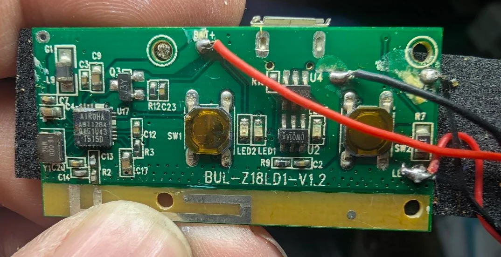
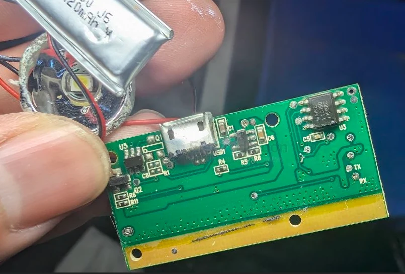

# AB1126-dat

- [[Airoha-dat]] - [[AB1126-dat]] - [[bluetooth-dat]] - [[bt3.0-dat]] - [[bt-shutter-dat]]

The Airoha AB1126A is a Bluetooth 3.0 integrated circuit (IC) manufactured by Airoha Technology Corp, commonly used in low-power wireless peripherals such as Bluetooth camera shutter remotes.

Key Specifications & Details

• Manufacturer: Airoha Technology Corp
• Wireless Standard: Bluetooth 3.0 (2.4 GHz, GFSK modulation, HID profile)
• Package: QFN32 (lead-free / RoHS compliant)
• Operating Temperature: -40°C to 105°C (per Veswin Electronics)
• Typical Power & Range: Often paired with a 3.0V CR2032 coin-cell battery; supports dormancy/sleep states and up to ~10 meters effective range in shutter remote applications.

Common Applications & Resources

• Consumer Peripherals: Found in compact Bluetooth remotes (such as the BT-4 shutter remote and AB Shutter 3), where it pairs as a keyboard/HID device to trigger camera or media actions.

## build 

- [[DW01-dat]] - [[8205-dat]] 

## ref 