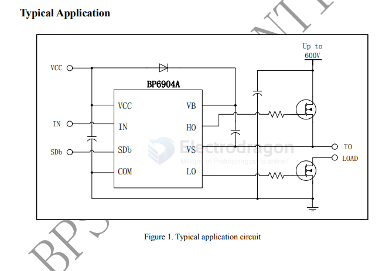

# BP6904-dat

- BP6904 - [[bps-dat]] - [[BP6904-dat]] - [[driver-pre-bridge-dat]]

## SCH 

Features
- ◼ Floating channel operation up to 600V
- ◼ Single input for high side and low side
- ◼ Shut down input turns off both channels
- ◼ Robust at negative transient voltage
- ◼ Gate drive supply range from 10V to 20V
- ◼ 3.3V, 5V and 15V input logic compatible
- ◼ UVLO for both high side and low side
- ◼ Built-in dead time
- ◼ Available in SOP8 package

## ref 

