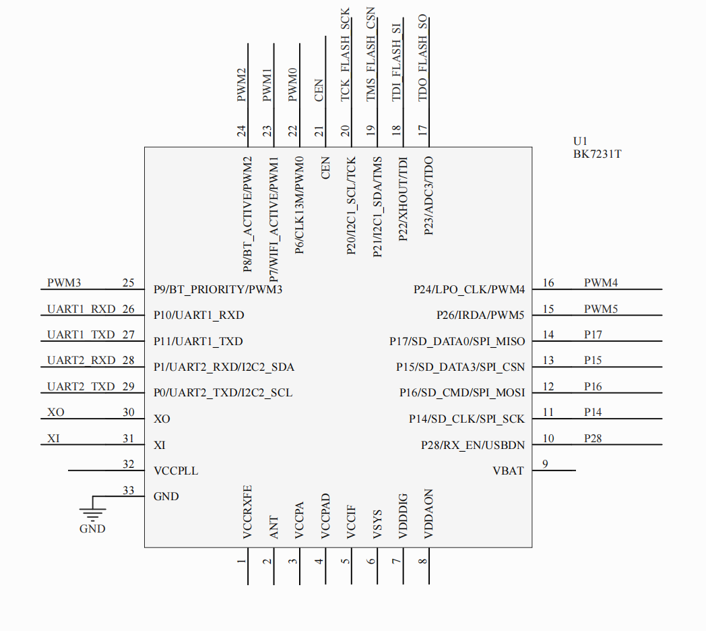
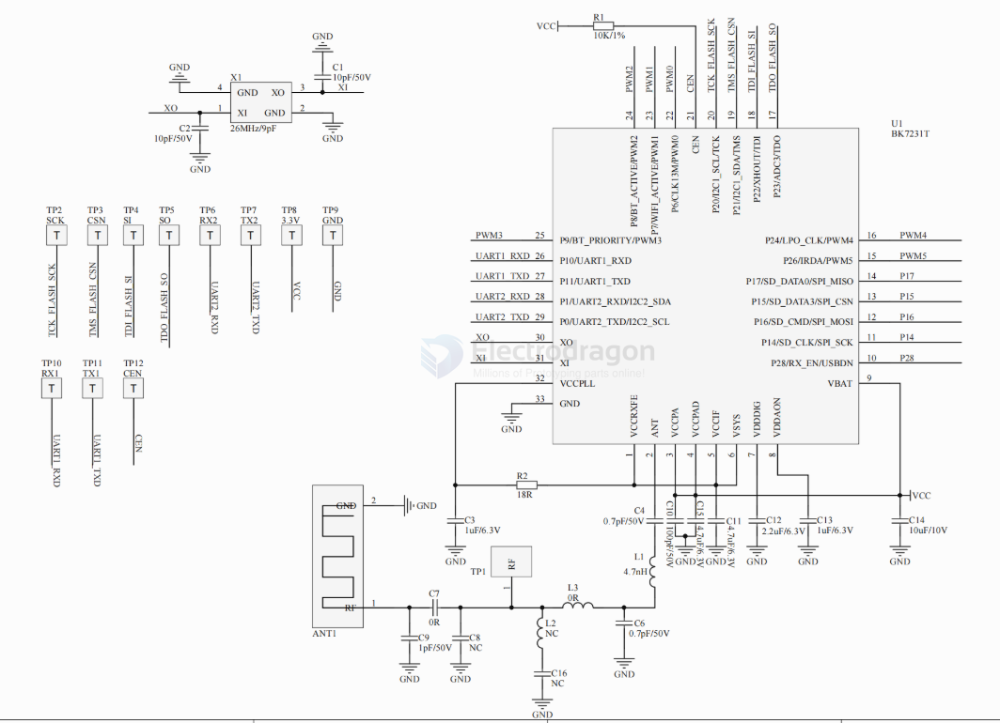
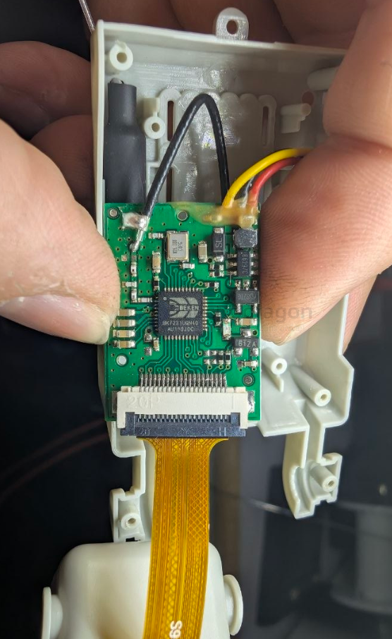
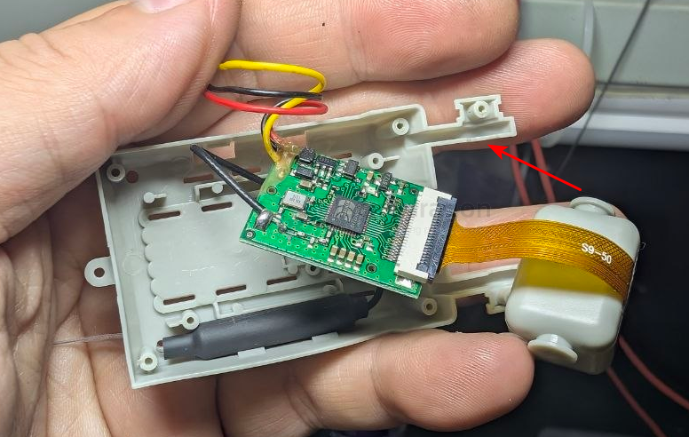

# BK7231-dat

- [[wifi-dat]] - [[IOT-dat]] - [[BK7231-dat]] - [[ESP32-dat]] - [[ESP8266-dat]]

- [[beken-dat]] - [[BK7231-dat]] - [[camera-digital-dat]] - [[2.4ghz-dat]] - [[FPV-toy-dat]]

- [[projects-dat]] - OpenBK7231T_App - https://github.com/openshwprojects/OpenBK7231T_App

The BK7231 is a low-cost, highly integrated Wi-Fi (802.11 b/g/n) and Bluetooth (BLE) system-on-chip (SoC) family manufactured by Beken Corporation.

## apps 

- [[camera-digital-dat]] - [[FPV-toy-dat]] 

- [[meter-energy-dat]]

## spec

| Item            | Detail                                                                                                   |
| --------------- | -------------------------------------------------------------------------------------------------------- |
| CPU             | 32-bit ARM968E-S (ARMv5TE) running up to 120 MHz                                                         |
| Memory          | 256 KB SRAM and built-in 2 MB SPI flash                                                                  |
| Wireless        | Wi-Fi 802.11 b/g/n (1x1) + Bluetooth Low Energy (BLE 5.0/5.2)                                            |
| Peripherals     | UART, I2C, SPI, SDIO, PWM, and 10-bit ADC channels                                                       |
| Common Variants | BK7231T and BK7231N, widely used inside Tuya-based smart home modules (such as the WB3S, CB2S, and WB2L) |

## minimal system 

QFN-24 - [[QFN-dat]] 

## pin table

| Pin Index | Role                  |
| --------- | --------------------- |
| 1         | VCCRXFE               |
| 2         | ANT                   |
| 3         | VCCPA                 |
| 4         | VCCPAD                |
| 5         | VCCIF                 |
| 6         | VSYS                  |
| 7         | VDDIG                 |
| 8         | VDDAON                |
| 9         | VBAT                  |
| 10        | P28/RX_EN/USBDN       |
| 11        | P14/SD_CLK_SPI_SCK    |
| 12        | P16/SD_CMD/SPI_MOSI   |
| 13        | P15/SD_DATA3/SPI_CSN  |
| 14        | P17/SD_DATA0/SPI_MISO |
| 15        | P26/IRDA/PWM5         |
| 16        | P24/LPO_CLK/PWM4      |
| 17        | P23/ADC3/TDO          |
| 18        | P22/XHOUT/TDI         |
| 19        | P21/I2C1_SDA/TMS      |
| 20        | P20/I2C1_SCL/TCK      |
| 21        | CEN                   |
| 22        | P6/CLK13M/PWM0        |
| 23        | P7/WIFI_ACTIVE/PWM1   |
| 24        | P8/BT_ACTIVE/PWM2     |
| 25        | P9/BT_PRIORITY/PWM3   |
| 26        | P10/UART1_RXD         |
| 27        | P11/UART1_TXD         |
| 28        | P1/UART2_RXD/I2C2_SDA |
| 29        | P0/UART2_TXD/I2C2_SCL |
| 30        | XO                    |
| 31        | XI                    |
| 32        | VCCPLL                |
| 33        | GND (bottom pad)      |

## IO features

Some of the more important BK7231 IO features are highlighted in the following table:

| Feature       | Description                               | Used pins                                        |
| ------------- | ----------------------------------------- | ------------------------------------------------ |
| UART1         | Programming/TuyaMCU/BL0942 interface port | UART1_RXD is P10, UART1_TXD is P11               |
| UART2         | Debugging/log output interface port       | UART2_RXD is P1, UART2_TXD is P0                 |
| I2C1          | First hardware I2C interface              | I2C1_SDA is P21, I2C1_SCL is P20                 |
| I2C2          | Second hardware I2C interface             | I2C2_SDA is P28, I2C2_SCL is P29                 |
| SPI Memory    | SPI port for flashing in SPI mode         | SCK is P20, CSN is P21, SI is P22, SO is P23     |
| SPI Interface | Hardware SPI for interfacing peripherals  | MISO is P17, CSN is P15, MOSI is P16, SCK is P14 |

## PWM map

BK7231 PWMs are widely used in RGBCW smart lighting. Here's the BK7231 PWM mapping:

| PWM  | IO  |
| ---- | --- |
| PWM0 | P6  |
| PWM1 | P7  |
| PWM2 | P8  |
| PWM3 | P9  |
| PWM4 | P26 |
| PWM5 | P24 |

## UART programming

BK7231 microcontroller comes with a preloaded UART bootloader in the 0x0 - 0x11000 flash memory section. Bootloader allows you to read and write the device flash memory by UART1 port.

Unlike in ESP8266/ESP8285 MCUs, there is no special pin used to enable bootloader mode. Bootloader is only enabled for a fraction of a second after device reboot.

To use TTL UART with your computer, you will need a USB to UART converter that supports 3.3V voltage levels. There are many converters like that on the market, but the one used frequently by us is CH340G:

The programming procedure is the following:
1. connect TXD1, RXD1, VDD and GND. Use UART to USB converter with 3.3V levels
NOTE: As always with UART, RX of one side should connect to TX of the other side, etc.
2. Start flash operation in the chosen tool
3. Reboot device, there are 3 ways to do it:
a) reboot by disconnecting power and reconnecting it
b) reboot by shorting CEN (RESET signal) to ground
c) reboot from firmware (for example, OpenBeken web panel has a 'restart' button
4. Wait for flashing procedure to finish.

The preferred simple GUI tool for flashing BK7231T and BK7231N is BK7231 GUI Simple Flasher:
https://github.com/openshwprojects/BK7231GUIFlashTool
Scroll down to see full BK7231 GUI Flasher Guide!
The old tool for Windows from Beken Corp is bkWriter 1.60:
https://github.com/openshwprojects/OpenBK7231T/blob/master/bk_writer1.60.zip
bkWriter 1.60 works well for BK7231T, but it may overwrite your bootloader if you try to write flash memory to address over 0x200000 because of address wrap. Still, it's safe to use it to write OpenBK7231T_UA_* file, as it's smaller than 2MB

## build 

## ref 

https://www.elektroda.com/news/news3951016.html