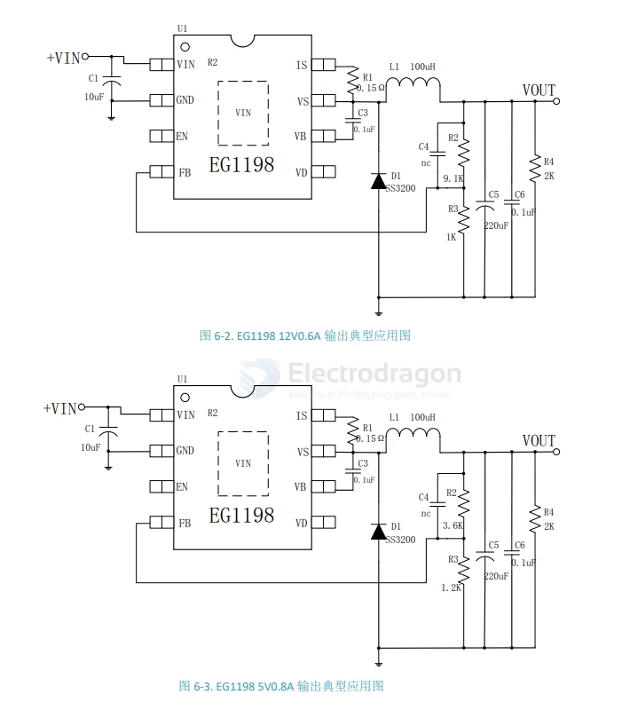
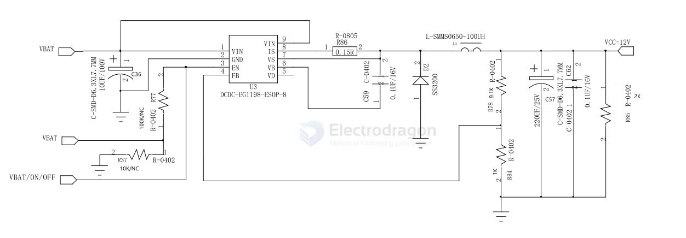

# EG1198-dat

- [[dcdc-down-dat]] - [[EG-micro-dat]] - [[EG1198-dat]] == 120V 1.5A 

The EG1198 (manufactured by EG Micro) is a wide-input-voltage, non-synchronous step-down (buck) DC-DC switching regulator IC in an ESOP-8 package.

Key Specifications

- • Topology: Step-down (Buck), non-synchronous (built-in power switch)
- • Input Voltage Range: 10V to 120V
- • Output Voltage Range: 1.25V to 13V (adjustable)
- • Max Output Current: 1.5A
- • Switching Frequency: 120 kHz
- • Quiescent Current: ~2 mA
- • Operating Temperature: -45°C to +125°C
- • Package: ESOP-8 (SMT)
- • Protections & Features: Enable control, cycle-by-cycle current limiting, overcurrent protection, short-circuit protection, and over-temperature protection

## SCH 

STD 

## build 

## ref 

