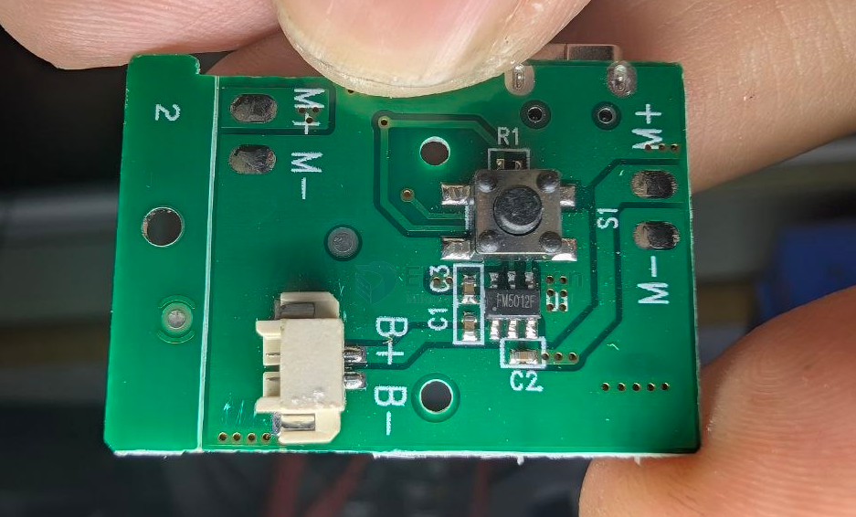

# FM5012F-dat

- [[fuman-dat]] - [[FM5012F-dat]] - [[fan-driver-dat]] - [[motor-driver-dat]] - [[motor-dat]]

## FM5012F

`FM5012F`集成充电与电机驱动的控制芯片

- FM5012F是一款应用于移动小风扇控制芯片，集成了锂电池充电管理，三种档位输出，并有状态LED指示的集成电源管理IC。
- FM5012F集成了涓流充电、恒流充电和恒压充电全过程的充电方式，浮充电压精度在全温度范围内可达土1%，并且具有充电电流纹波小、充电效率高等优点。
- FM5012F直接脉冲方波输出驱动风扇。
- FM5012F具有负载过流保护、输出短路保护、软启动、输入过压保护及芯片温度保护等多重保护功能。芯片端口都设计了高性能的ESD保护电路，具有极高的可靠性。FM5012F目前提供 SOT23-6的封装形式。

The FM5012F is an integrated circuit (IC) manufactured by Fuman, designed primarily for controlling mobile small fans, handheld warmers, massagers, and other compact portable devices powered by a lithium battery.

Key Features and Specifications

• Package: SOT23-6 surface-mount package.
• Core Functions:
	• Lithium battery charging management (supports trickle, constant current, and constant voltage stages with ±1% float voltage accuracy).
	• Three-gear/three-speed output control for DC motors (e.g., small fan speeds).
	• Status LED indication (typically 2-light display).
	• Direct pulse square wave (PWM) fan drive.
	• Low standby current (around 7µA).
• Built-in Protections:
	• Load overcurrent protection
	• Output short-circuit protection
	• Soft start
	• Input overvoltage protection
	• Chip over-temperature protection
	• High ESD reliability
• Common Applications: Handheld USB/lithium battery fans, mini massagers, portable LED drivers, and hand warmers.

## build 

## ref 

