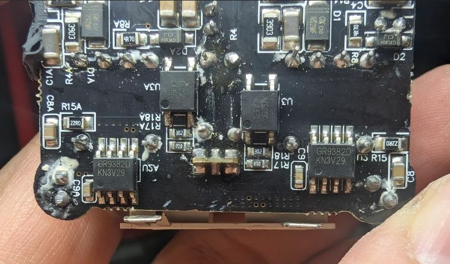
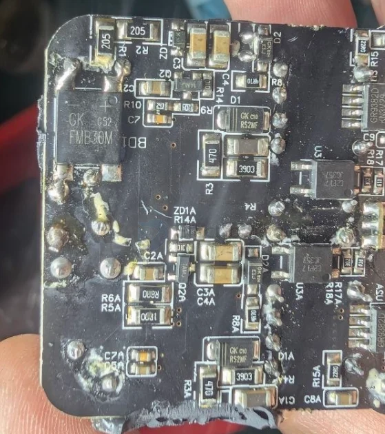

# GR9382-dat

- [[Grenergy-dat]] - [[GR9382-dat]] - [[acdc-dat]]

The GR9382D (part of the GR9382 series by Grenergy / 南京绿芯) is a high-performance secondary-side synchronous rectifier controller IC in an SOP-8 package with an integrated MOSFET.

Key Features & Specs

• Function: Secondary-side synchronous rectifier controller with an integrated 40V–120V MOSFET.
• Output Voltage Range: 3.3V–20V applications.
• Operating Modes: Supports CCM (Continuous Conduction Mode), QR (Quasi-Resonant), and DCM (Discontinuous Conduction Mode).
• Switching Frequency: Supports up to ~160 kHz.
• Power Supply: Proprietary VCC self-powered technology (no extra winding required), reducing external component count and cost.
• Protections: VCC under-voltage lockout (UVLO), VCC over-voltage clamp, drive pin noise/glitch immunity, and ~25ns typical TSR detection time.
• Package: SOP-8.

## build 

C2P17 JG357 JC357

GK
FMB30M 

## ref 