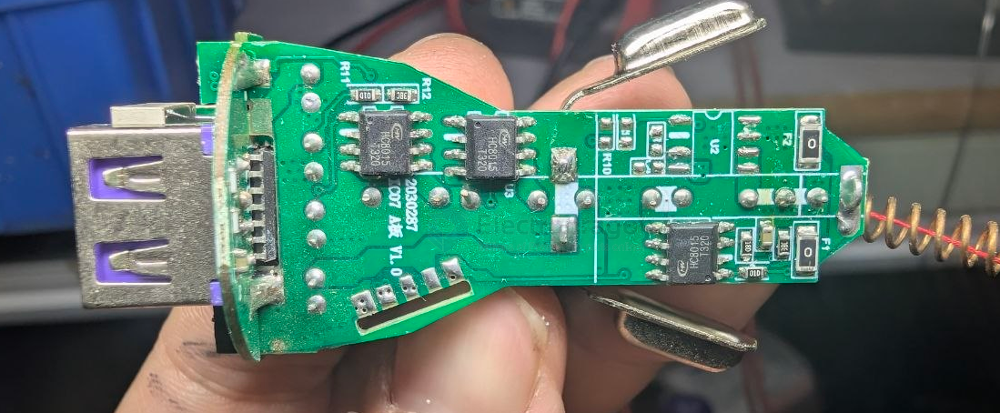
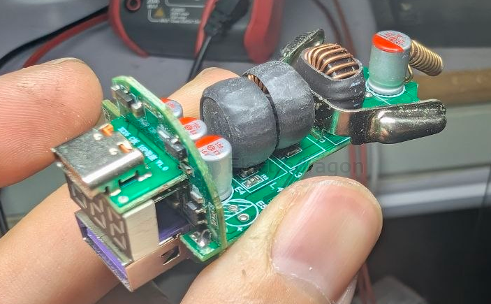

# LCWsemi-dat

- [[dcdc-down-dat]] - [[LCWsemi-dat]] - [[HC8015-dat]]

- [[PCB-stack-dat]] - [[power-bank-dat]]

- 型号：	HC8015
- 功能:	Buck
- 输出电流:	3.6A/5V
- 封装:	SOP-8
- 输入电压:	8V-32V
- FB电压:	0.6V

## build 

## ref 