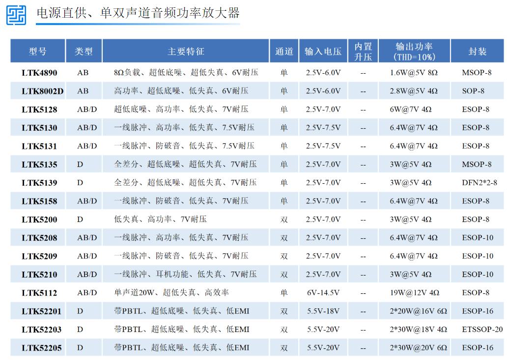
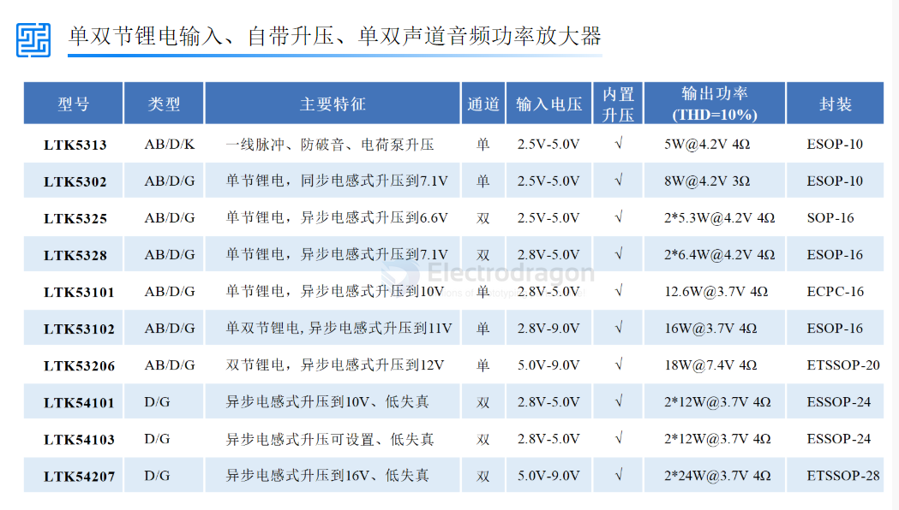

# LTK-dat

LTK5313是一款内置自适应升压F类音频功率放大芯片，具有AGC防破音功能、AB/D类模式切换、自适应、超低底噪、超低EMI。自适应升压在输出幅度较小时升压电路不工作，功放直接由电源供电，当输出较大时内部自动启动升压电路，功放供电电压为升压电压，达到更大的输出功率。LTK5313有四种AGC模式可选择，能满足各种不同的需求，并且保护扬声器避免过载而损坏。芯片具有AB/D类切换功能，AB类时可减少功放对FM干扰。全差分结构有效的提高功放对RF噪声抑制。Charge Pump升压方式，无需外部电感、肖特基二极管、达到尽可能减少外围元件，节省成本的目的。

 

二、芯片应用

蓝牙音箱、智能音箱

导航仪、便携游戏机

拉杆音箱、DVD、扩音器、MP3、MP4

智能家居等各类音频产品

## ref 

- [[LTK]]