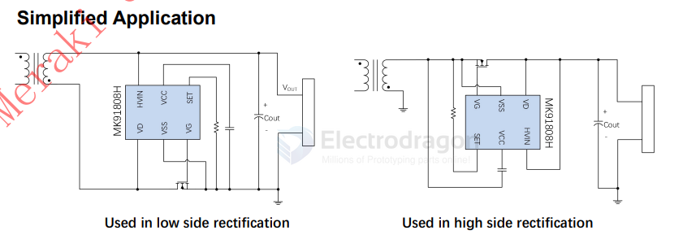
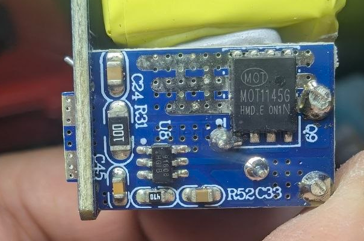

# MK91808-dat

- [[Meraki-dat]] - [[MK91808-dat]] - [[acdc-dat]]

Ultra-Fast Turn-off Synchronous Rectifier Controller

MK91808H

Description
The MK91808H is a compact secondary side
synchronous rectifier controller and driver for
high performance flyback converters. It is
optimized for both ACF and high frequency QR.
It is compatible with DCM, CCM and QR
operations. The MK91808H generates its own supply while
used in high-side rectification, which eliminates
the need of external supply generated by
auxiliary winding of the transformer. The extremely low 10ns turn−off propagation
delay time and high sink current (~4A)
capability of the driver improve SR VDS stress
at CCM mode. The unique VG clamping circuit works well to
prevent VG from turning on by fast rising at
VD pin with no VCC, that avoids the shoot
through between primary side and secondary
side during system startup even if the SR
VCC is still below 2V. Typical Applications
 AC/DC Adapters for Mobile Phone and
Notebook
 High Power density AC/DC Power
Supplie

Features
 Optimized for <1MHz Frequency
 Supports DCM, QR and CCMOperations Supports Active Clamp Flyback withGaNFETor Super-junction MOSFET at Primary Side Operates in a Wide Output VoltageRangeDown to Zero Voltage
 Self-supply for Operation with LowOutput
Voltage and/or High–side Rectificationwithout
an Auxiliary Winding
 Gate Drive Voltage is Up to 9V
 10ns Fast Turn-off and 25ns Turn-onDelay VD/HVIN Pin Supports NegativeVoltageSpikes Down to -3V
 Avoids Potential False Turn-on duringDCM VG Clamping Circuit Works Well whenVCCisBelow 2V
 Supports both High-side and Low-sideRectification
 Adaptive Gate Drive for MaximumEfficiency SOT23-6

## sch 

std 

## build 

- [[MOT1145-dat]] - [[MK91808-dat]] - [[acdc-dat]]

## ref 