# TP4056-dat

- [legacy wiki page](https://w.electrodragon.com/w/TP4056)

- [[battery-dat]] - [[battery-pack-dat]]

- [[battery-protector-1s-dat]] - [[battery-charger-1s-dat]] - [[battery-1s-dat]]

- [[battery-protector-dat]] - [[battery-charger-dat]] - [[battery-packs-dat]]

## boards 

- [[OPM1156-dat]] - [[OPM1083-dat]]

## tutorial

how to use single [[TP4056-dat]] to charge - [[battery-charger-2s-dat]] - [[2S-lithium-battery-charger-dat]]

## Parameters 

cacultation: 

    Ibat = charge current = Vprog / Rprog * 1200

    where Vprog = 1V 

| Rprog | Ibat   | calculation   |
| ----- | ------ | ------------- |
| 1.2K  | 1A     | 1.2/1.2 = 1   |
| 120 R | 10 A   | 1.20.12 = 10  |
| 2.4K  | 500 mA | 1.2/2.4 = 0.5 |
| 2K    | 580 mA |
| 1.5K  | 780 mA |

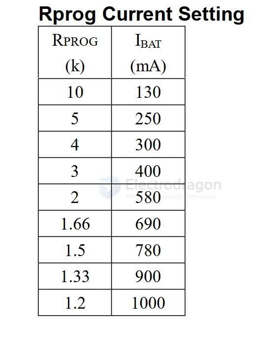

## SCH 

build SCH `LGS4056` - [[legend-SI-dat]]

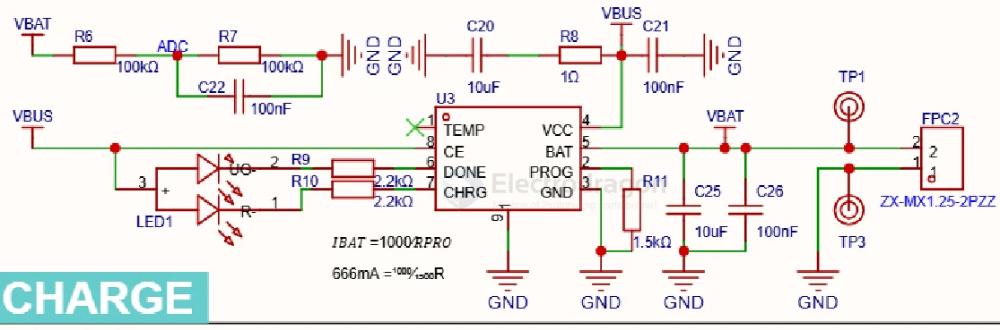

SCH 1 

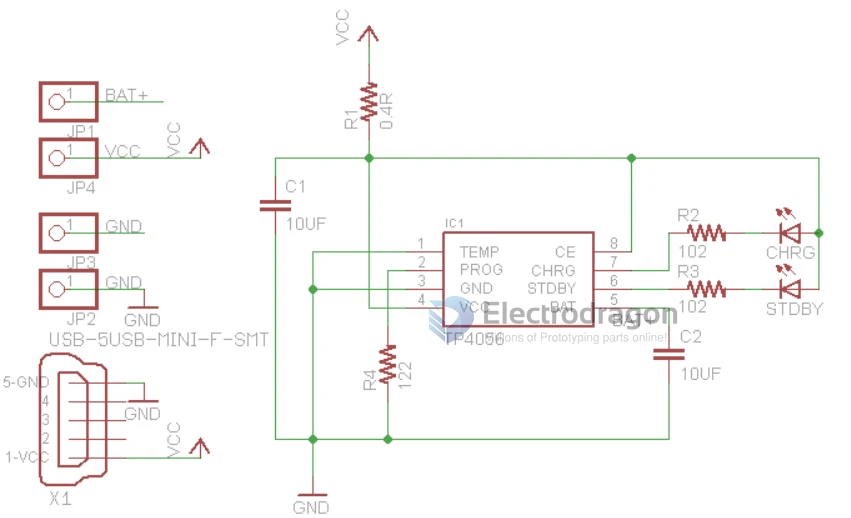

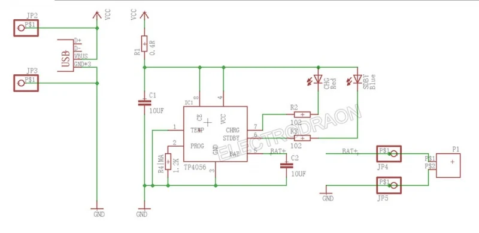

## Solar Type-C Solutions 

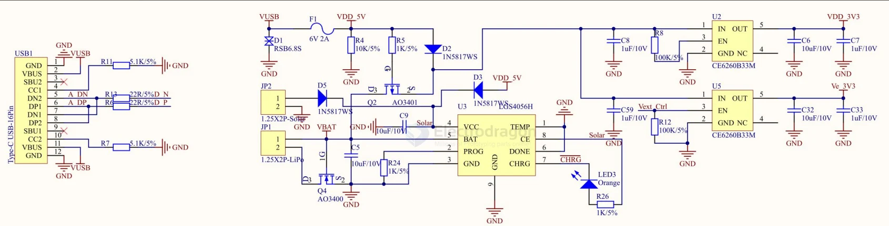

## batter options than 

- [[MCP73871-dat]] - [[CN3791-dat]]

## demo 

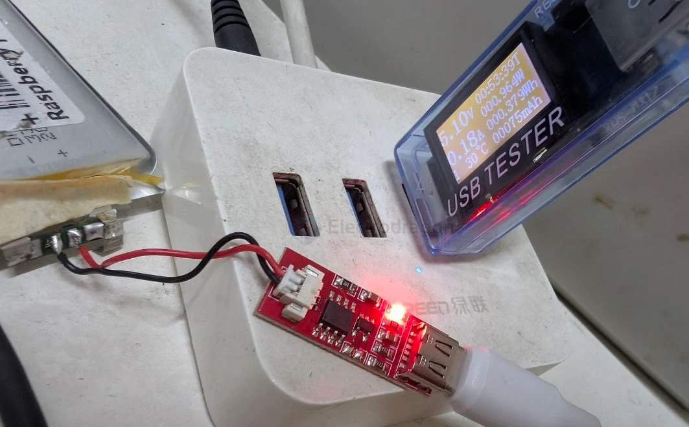

## build 

- [[HX4004-dat]] - [[TP4056-dat]] - [[dcdc-boost-dat]] - [[battery-charger-1s-dat]]

build 4 

- TC4056 

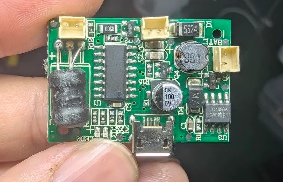

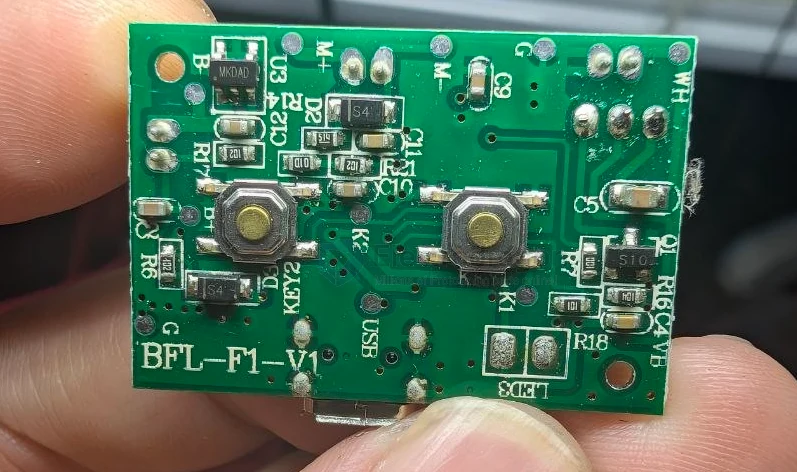

build 3 SCH 

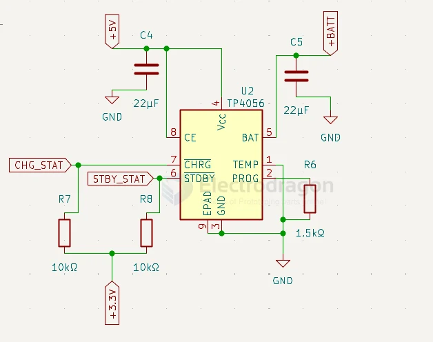

- CHG_STAT == to [[ESP32-dat]]
- STBY_STAT == to [[ESP32-dat]]

build 2 

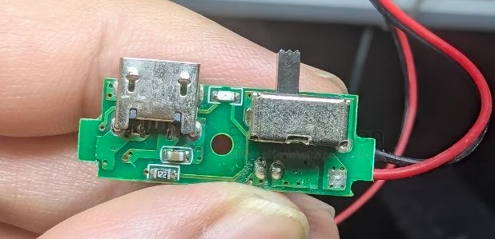

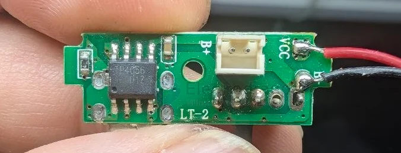

unknown drive board 

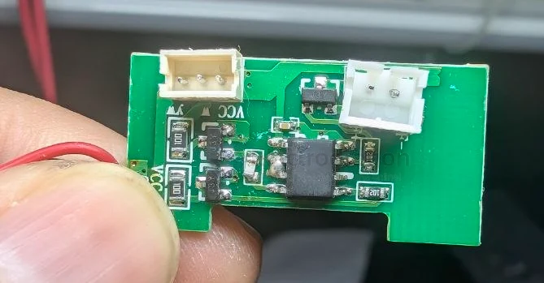

build 1 

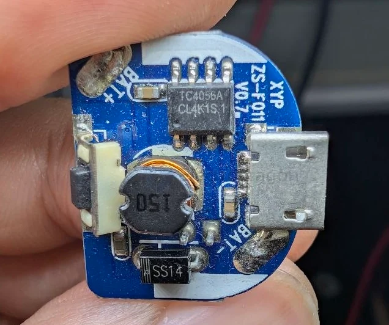

## ref 

- datasheet - [[TP4056.pdf]]

- [[TP-dat]]