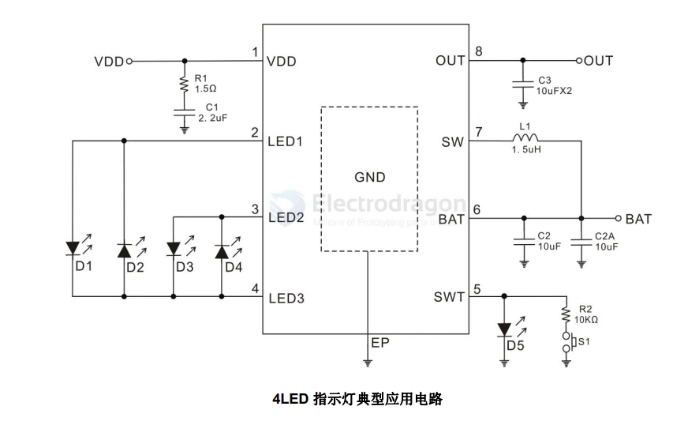

# TP4336-dat.md

- [[TP4336-dat]] - [[TP-dat]] - [[battery-portable-dat]]

1A同步移动电源解决方案

TP4336 是一款集成线性充电管理、同步升压转换、电池电
量指示和多种保护功能的单芯片电源管理 SOC，为移动电
源等锂电池电子设备提供完整的单芯片电源解决方案。

TP4336 内部集成了线性充电管理模块、同步升压放电管理
模块、电量检测与 LED 指示模块和多种保护模块。TP4336
内置充电与放电功率 MOS，充电电流固定为 1A。最大同
步升压输出电流为 1A，放电负载的轻载关机电流为 50mA。
TP4336 的待机功耗低，芯片关机后并且负载开路时，
TP4336 的待机电流可低至 14uA。

TP4336 内部集成了温度补偿、过温保护、过充与过放保护、
输出过压保护、输出过流保护、输出短路保护等多种安全
保护功能以保证芯片和锂离子电池的安全。TP4336 应用电
路简单,只需很少的外围元件便可以实现锂电池充放电的完
整方案，极大的节省了系统的成本和体积。

特点
-  线性充电，同步升压
-  集成电源路径管理，支持边充边放
-  1A 输出时放电效率高达93% 最大升压输出电流1A
-  充电电流 1A
-  待机电流低至14uA
-  轻载关机电流50mA
-  负载自动检测开关机 按键单按开机，双按关机 支持手电筒输出 充电电流自适应技术 智能温度控制与过温保护 封装形式：ESOP-8L

应用
-  移动电源
-  锂电池电子设备
-  其他小功率电源管理应用

## SCH 

STD

OUTPUT 5V 

## apps 

- [[radio-tx-dat]] - [[TP4336-dat]] - [[TP-dat]] - [[battery-portable-dat]]

- [[TP4336-dat]] - [[drone-PCB-dat]]

## ref 