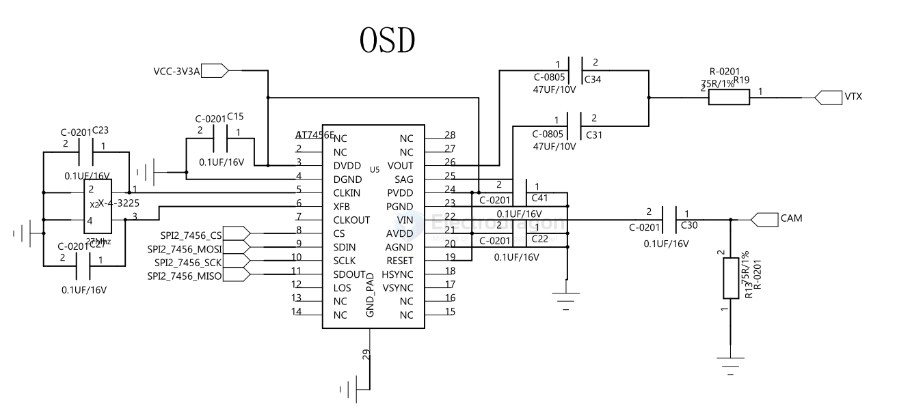

# AT7456E-dat

- [[AT7456E-dat]] - [[zhongkewei-dat]] - [[X12-dat]]

The AT7456E is a single-channel, monochrome on-screen display (OSD) integrated circuit manufactured by ZHONGKEWEI (Hangzhou ZhongKe Microelectronics). 

It is widely used in FPV (First-Person View) racing drones, hobbyist UAVs, and fixed-wing flight controllers to overlay real-time telemetry data—such as battery voltage, current, and artificial horizons—directly onto analog video feeds. 

## SCH 

## use 

- [[X12-dat]]

## build 

- [[flight-controller-dat]]

## ref 