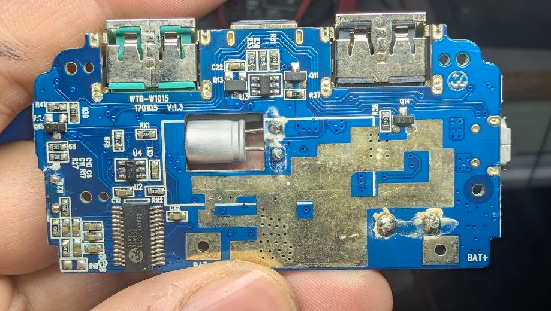
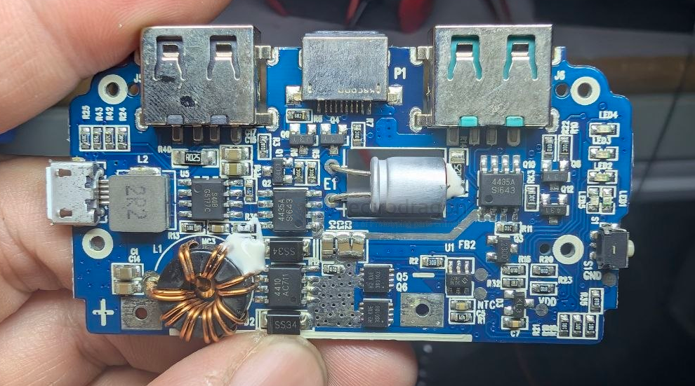
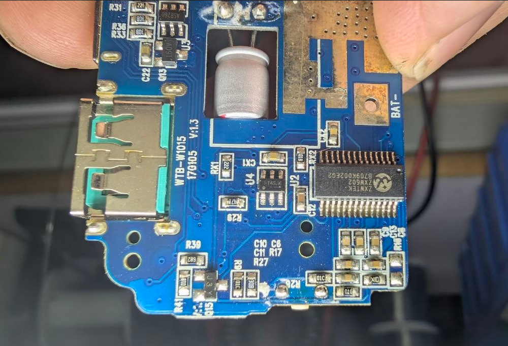
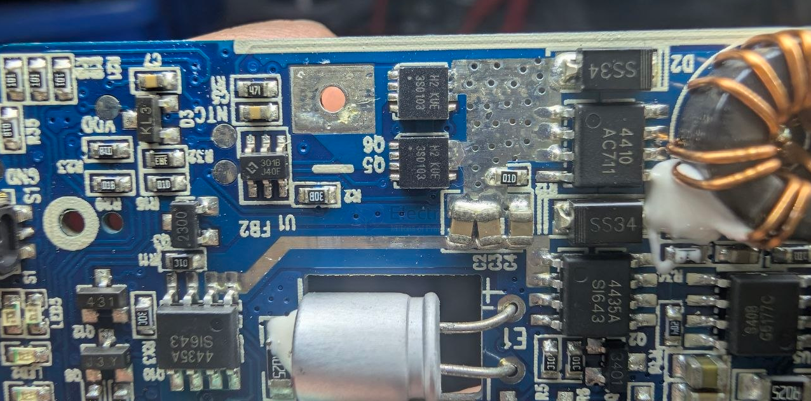

# ZXW602-dat

- [[ZXWTEK-dat]] - [[ZXW602-dat]]- [[power-bank-dat]] - [[capacitor-Electrolytic-dat]] - [[capacitor-dat]]

The ZXWTEK ZXW602 is a specialized dual-port fast-charging power management IC (integrated circuit) designed primarily for mobile power banks. Manufactured by ZXWTEK, this single-chip solution handles bidirectional charging, discharging, battery capacity measurement, and safety protection.

- [[qualcomm-dat]] - [[USB-QC-dat]] - [[FT4SJK-dat]]

- [[mosfet-dat]] - 4435A - [[AOSMD-mosfet-dat]] - [[ZXW602-dat]] 

- [[AO4435A-dat]] - [[AO4410-dat]] - [[AOSMD-mosfet-dat]] - [[ZXW602-dat]] - [[mosfet-dat]] 

H2 KUE 3S0103

- [[battery-protector-1s-dat]] - [[HY2113-dat]] - [[HYCON-dat]] - [[ZXW602-dat]]

- [[DCDC-boost-dat]] - [[GMT-dat]] - [[G5177C-dat]]

## ref 

