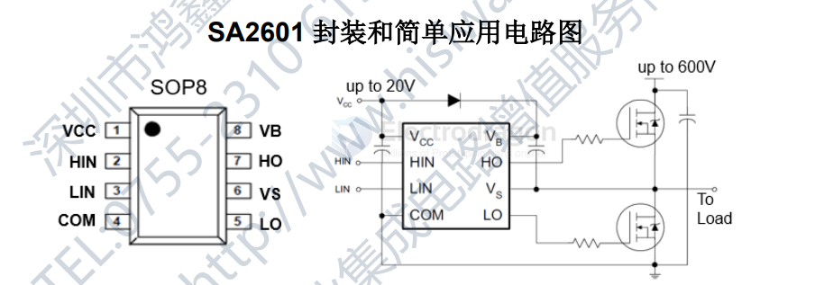

# SA2601-dat

- [[sytatek-dat]] - [[SA2601-dat]] - [[LKS620-dat]] - [[LKS-dat]] - [[belling-dat]]

SA2601是一款针对于双NMOS的半桥栅极驱动芯片，专为高压、高速驱动N型功率MOSFET和IGBT设计，可在高达600V电压下工作

SA2601内置VCC和VBS欠压（UVLO）保护功能，防止功率管在过低的电压下工作，提高效率，

SA2601输入脚兼容3.3-15.0V输入逻辑，上下管延时匹配最大为50ns，驱动能力为+0.3A/-0.6A。

SA2601采用SOP8封装

- [[mosfet-HV-dat]] - [[IGBT-dat]] - [[mosfet-dat]]

## ref 

