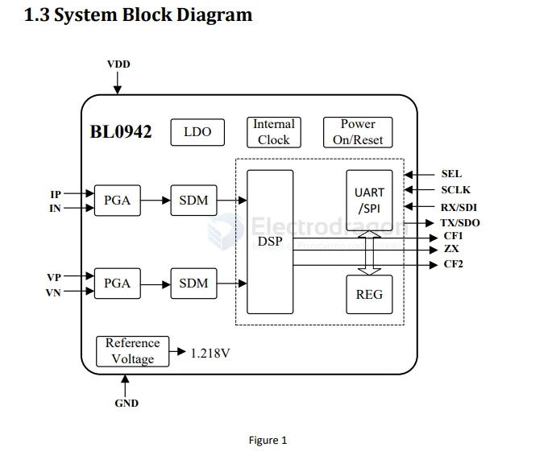

# belling-dat

- [[LDO-dat]] - [[belling-dat]] - [[BL8062-dat]] - [[USB-SDK-type-C-dat]]

- [[Sytatek-dat]] - [[belling-dat]] - [[HDSC-dat]]

- [[BL0942-dat]] - [[meter-energy-dat]] - [[belling-dat]]

## BL0942 

https://www.belling.com.cn/media/file_object/bel_product/BL0942/datasheet/BL0942_V1.06_en.pdf

diagram 

这颗是正经货，不是白牌。官方资料写得很清楚：两路独立的 Sigma-Delta ADC，一路测电流一路测电压，内置 1.218V 基准和约 4MHz 时钟，出厂批次增益误差小于 1%，外围器件配好了可以免校准。功耗 10mW，3.3V 供电。

它还能算有功功率、有功电能、电流电压有效值，能输出过流报警和过零信号。也就是说，功率和电量是在这颗芯片里算完的，主控只负责读数和显示，不负责算。

这个分工很重要。低端电量计常见的做法是让主控用 ADC 采样再自己算，算法粗糙、温漂大，读数飘得厉害。BL0942 这种专用计量芯片把乘法器和滤波器都做在片内，一致性要好得多。

采样靠的是一颗 1 毫欧的电阻，丝印 R001，焊在火线或零线的回路上。

## ref 

