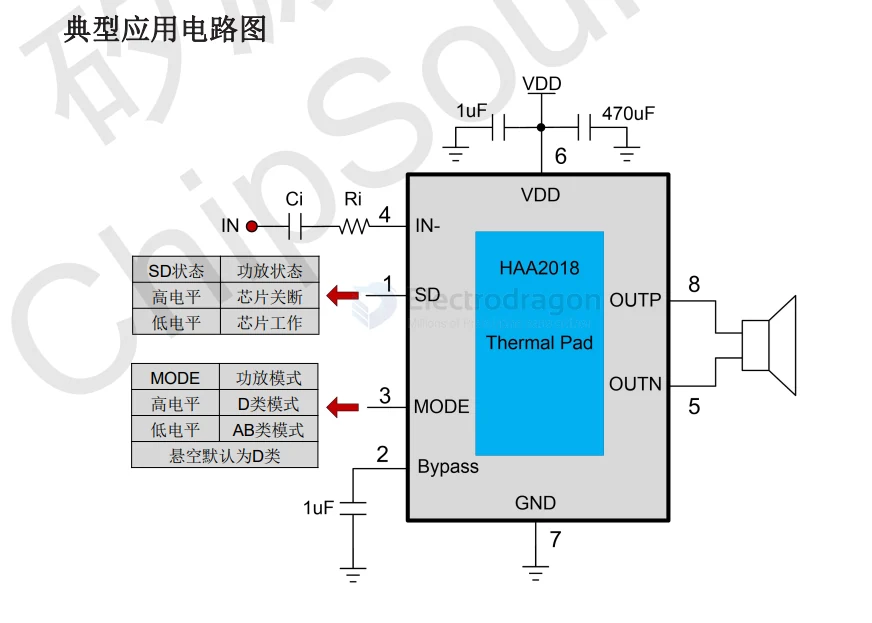

# HAA2018-dat

- [[HAA2018-dat]] - [[chipsourcetek-dat]] - [[massager-dat]]

HAA2018是一款FM无干扰、AB/D类可切换、高效率、
无滤波器的5.3W单声道音频功率放大器。超低的EMI
非常适合应用于带FM功能的便携式设备中。
HAA2018的单端输入架构和极高的PSRR有效地提高
了HAA2018对RF噪声的抑制能力。无需滤波器的
PWM调制结构及增益内置方式减少了外部元件、PCB
面积和系统成本,并简化了设计。高达90%的效率,快速
地启动时间和纤小的封装尺寸使得HAA2018成为便携
式音频产品的最佳选择。
HAA2018具有极低的关断电流，极大的延长系统的待
机时间。OCP、OTP、UVLO保护功能增强系统的可
靠性。开启、关闭POP-click抑制功能改善了系统的听
觉感受，同时简化系统调试。
HAA2018提供带散热片的ESOP8封装

特性
-  AB类、D类切换功能
-  D类输出功率：
- －5.3W (VDD=5.0V, RL =2Ω，THD+N=10%) 
- －3.2W (VDD=5.0V, RL =4Ω，THD+N=10%)
-  AB类输出功率：
- －5.2W (VDD=5.0V, RL =2Ω，THD+N=10%) 
- －3.1W (VDD=5.0V, RL =4Ω，THD+N=10%)
-  工作电压范围：2.5V to 5.5V
-  低失真和低噪声
-  开启、关闭POP-click抑制功能
-  关断电流（<1uA）
-  OCP、OTP、UVLO保护功能

应用
-  扩音器
-  便携式音箱 / 插卡音箱
-  蓝牙音箱 / USB音箱

## SCH 

STD 

- [[HAA2018-dat]] - [[chipsourcetek-dat]] - [[Massager-dat]] - [[AC7916-dat]] 

## ref 