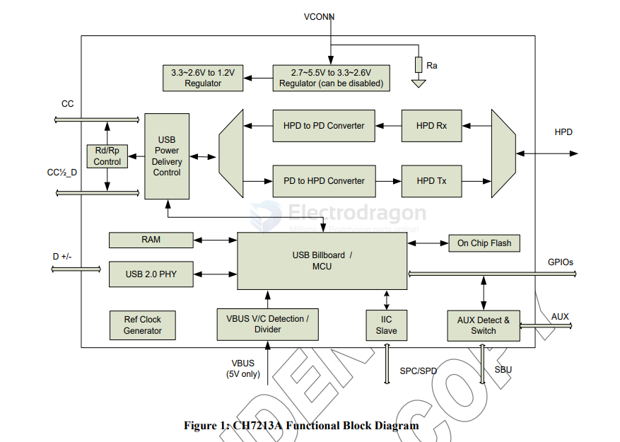
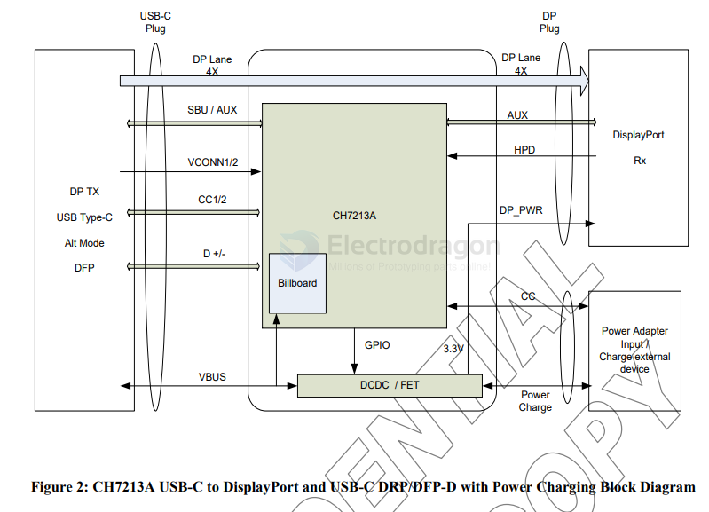
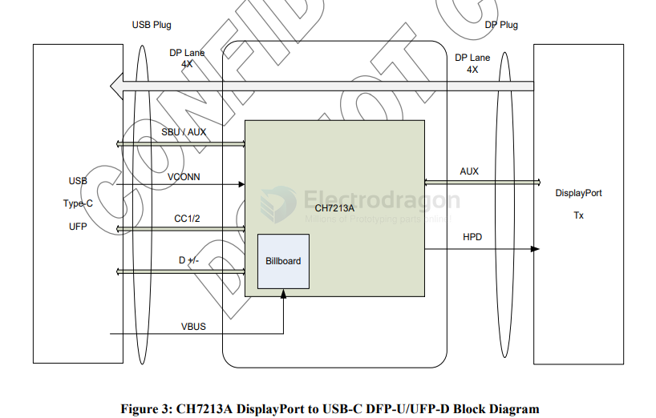

# CH7213A-dat

- [[chrontel-dat]] - [[CH7213A-dat]] - [[USB-type-C-dat]] - [[displayport-dat]]

## GENERAL DESCRIPTION

Chrontel’s CH7213A is a low cost USB Type-C logic controller. The device is targeted for system designers implementing USB Type-C devices with DisplayPort capabilities and USB Power Delivery 2.0 support. The CH7213A integrates the USB Type-C plug orientation and attached detection mechanism on the CC (Channel Communication) pins. Its robust Power Delivery 2.0 module using the BMC protocol can enable USB Type-C devices operating in various power management roles including Consumer, Provider and Power Role Swap.

The DisplayPort Alt. mode is another alternative interface supported in the CH7213A. A built-in Billboard Class can be automatically exposed to the USB 2.0 D+/- bus if a Type-C PD Source (DFP) does not equip USB Type-C Alt. Mode features that support DisplayPort signal transmission. The system with CH7213A’s DisplayPort Alt. mode enabled can be programmed to support Type-C to DisplayPort display or DisplayPort to a Type-C DP Alt. mode monitor. The CH7213A’s bi-directional signal converter for the DisplayPort HPD (hot plug detection) and VDM (Vendor Defined Message) is capable of translating the HPD to the appropriated VDM to Type-C DP device and vice versa. In addition to hardware support of PHY and Link layers, the CH7213A has an internal microprocessor to handle the cable logic communication and can be programmed for customization according to the application of USB TypeC platforms. For reducing the BOM cost of final products, the CH7213A integrates all necessary components and circuits, such as LDO, clock generation isolation circuit, Ra, Rd and Rp etc. 

## FEATURES

-  Compliant with Type-C Specification Revision 1.2
-  Compliant with the Power Delivery Specification Revision 2.0, Version 1.1
-  Supports VESA DisplayPort Alt. Mode 1.0a
-  Bi-directional conversion between the HPD signal and Power Delivery VDM
-  Support DisplayPort AUX Channel DC voltage level detection
-  Configurable USB Type-C Ports. Device can be designed with Type-C plug or Type-C receptacle connector. CC logic and Power Delivery protocol support one sink port and one charging port
-  Rp and Rd resistors integrated
-  Built-in Ra termination resistor
-  USB Type-C SBU and DisplayPort AUX Channel switch integrated
-  Support Type-C plug orientation detection
-  Integrated USB Billboard Class, Version 1.21 for supporting USB Type-C Alt. Mode
-  Support VCONN power. 5V to 3.3V and 3.3V to 1.2V Regulator integrated to save BOM cost
-  Embedded MCU and flash
-  IIC slave interface
-  Firmware update capability
-  Crystal free
-  RoHS compliant and Halogen free package
-  Offered in 16-Pin QFN (4x4 mm)

## diagram 

- [[chrontel-dat]] - [[CH7213A-dat]] - [[USB-type-C-dat]] - [[displayport-dat]]

Figure 2: CH7213A USB-C to DisplayPort and USB-C DRP/DFP-D with Power Charging Block Diagram

Figure 3: CH7213A DisplayPort to USB-C DFP-U/UFP-D Block Diagram

## ref 