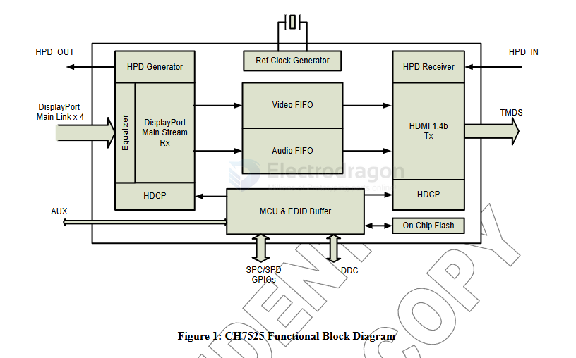

# CH7525A-dat

- [[chrontel-dat]] - [[CH7525A-dat]] - [[HDMI-dat]] - [[displayport-dat]] - [[USB-type-c-dat]]

- [[CH7525-Brief-Datasheet-1.1.pdf]]

## diagram 

## info

- Compliant with DisplayPort Specification version 1.2a and Embedded DisplayPort (eDP) Specification version 1.3
- Up to 4 Main Link Lanes at either 1.62Gb/s or 2.7Gb/s (HBR) link rate supported
- Support color depth 6/8/10/12bits
- HDMI transmitter compliant with HDMI specification version 1.4b and DVI specification version 1.0
- HDMI transmitter supports up to 300 MHz TMDS clock, and supports up to 3.0Gbps data rate for video timing of 1920x1080@120Hz or 4Kx2K@30Hz
- Supports Enhanced Framing Mode
- Fast and full Link Training for embedded DisplayPort system
- Support eDP Authentication: Alternative Scramble Seed Reset and Alternative Framing
- DisplayPort receiver auto equalization supported for the compensation of input signal attenuation
- Support Spread Spectrum Clocking (de-spreading) for EMI reduction
- HDCP engine compliant with HDCP 1.4 specification with internal HDCP Keys
- On-chip Audio Decoder which support 8 channel Audio input from DP Rx and output from HDMI Tx with sample rate up to 192KHz
- Embedded MCU to handle the control logic
- Support device boot up by loading firmware from On Chip Flash automatically
- Integrated EDID Buffer
- 2 work modes: connect 27MHz crystal, inject 27MHz clock
- DP input detection supported
- Support Auto Power Saving mode and low stand-by current
- DP AUX channel and IIC slave interface are available for firmware update and debug
- Low power architecture
- RoHS compliant and Halogen free package
- HBM 4KV ESD Performance
- Offered in 48-Pin QFN package (6 x 6 mm)

## ref 

