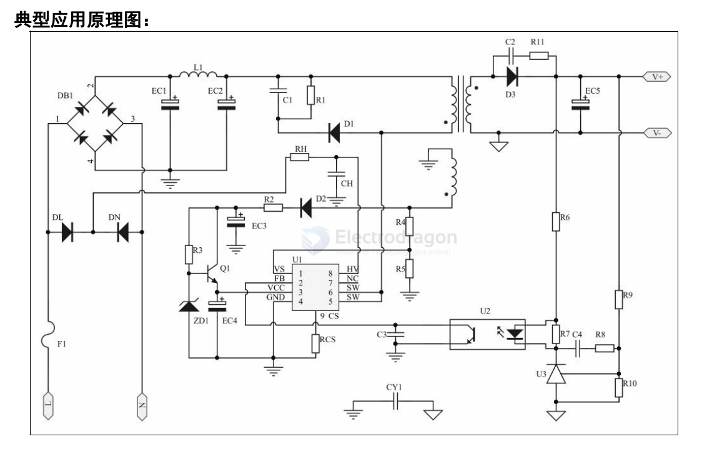
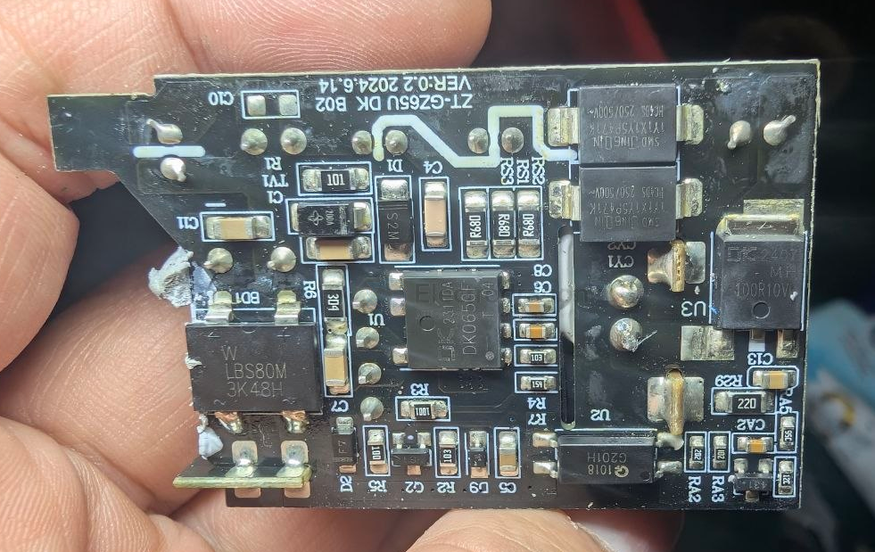

# DK065-dat

- [[DK065-dat]] - [[dongke-dat]] 

产品概述：

DK065GF 是一款高度集成了 700V/260mΩ GaN HEMT 的准谐振反激控制AC-DC 功率开关芯片。DK065GF 检测功率管漏极和源极之间的电压（VDS）,当 VDS达到其最低值时开启功率管，从而减小开关损耗并改善电磁干扰（EMI）。

DK065GF 极大的简化了反激式 AC-DC 转换器的设计和制造，尤其是需要高转化效率和高功率密度的产品。DK065GF 具备完善的保护功能：输出过压保护（OVP），VCC 过欠压保护，过温保护（OTP），开环保护，输出过流保护（OCP）等

High-performance AC-DC gallium nitride power management chips

高性能 AC-DC 氮化镓电源管理芯片

## SCH 

std 

## build 

LBS80M

DK2407 100R10VL 100R10VI

- [[DK2407-dat]] - [[dongke-dat]] - [[DK065-dat]]

## ref 

