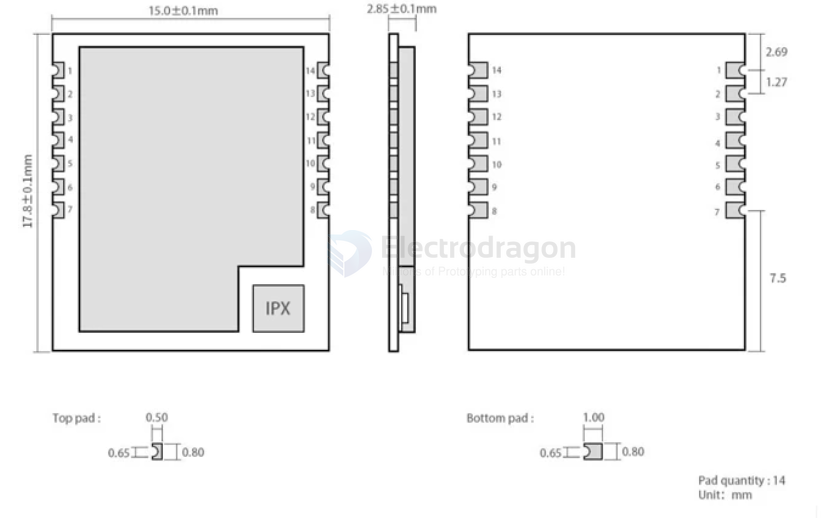
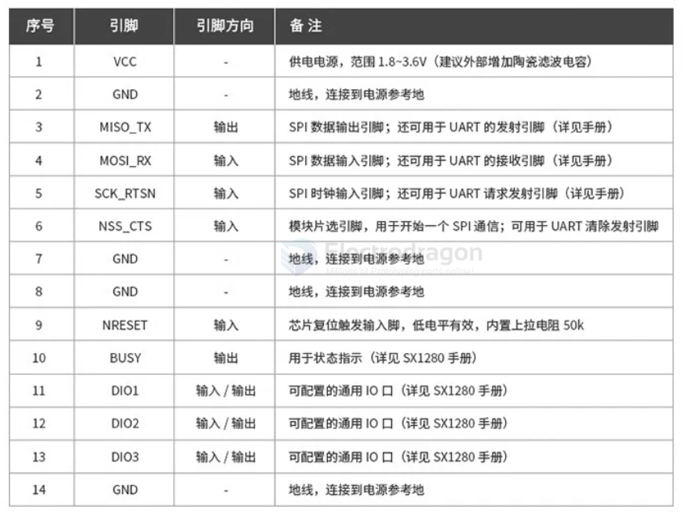

# E28-dat

- [[ebyte-dat]] - [[E28-dat]] - [[SX1280-dat]]

- [[ELRS-dat]] - [[ELRS-TX-dat]] - [[ELRS-TX-HDK-dat]] - [[ESP32-C3-dat]] - [[espressif-dat]] - [[ebyte-dat]] - [[E28-dat]] - [[SX1280-dat]] - [[semtech-dat]]

- [[RF-power-transmit-dat]] - [[RF-dat]]

## selection

- E28-2G4M12S｜不带天线
- E28-2G4M12S｜已配FPC天线
- E28-2G4M12S｜已配胶棒天线
- E28-2G4M12SX｜不带天线
- E28-2G4M12SX｜已配FPC天线
- E28-2G4M12SX｜已配胶棒天线
- E28-2G4M20S｜不带天线
- E28-2G4M20S｜已配FPC天线
- E28-2G4M20S｜已配胶棒天线
- E28-2G4M20SX｜不带天线
- E28-2G4M20SX｜已配FPC天线
- E28-2G4M20SX｜已配胶棒天线
- E28-2G4M27S｜不带天线
- E28-2G4M27S｜已配FPC天线
- E28-2G4M27S｜已配胶棒天线
- E28-2G4M27SX｜不带天线
- E28-2G4M27SX｜已配FPC天线
- E28-2G4M27SX｜已配胶棒天线

## info 

pin definitions 

## ref 

- [[ebyte]]