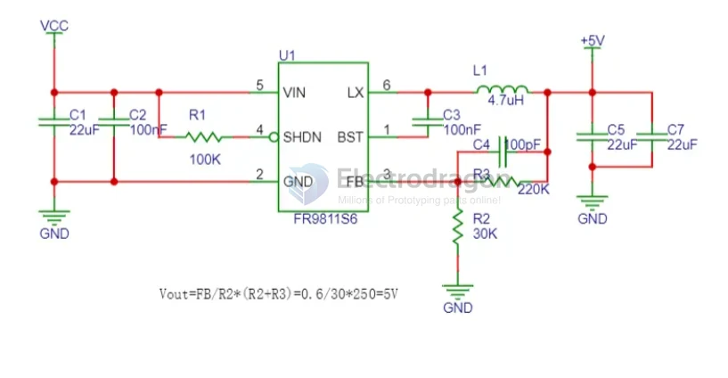

# fitipower-dat

- [[fitipower-dat]] - [[FP6185-dat]] - [[LDO-dat]]

- [[fitipower-dat]] - [[FP6601-dat]]

- [[fast-charge-protocols-dat]] - [[USB-QC-dat]]

## FR9811 

- [[FR9811-dat]] 

The `FR9811` (often designated as FR9811S6 or FR9811S6CTR) is a monolithic synchronous step-down (buck) DC/DC converter manufactured by Fitipower.

Key Specifications

• Function: Synchronous step-down DC/DC regulator IC
• Input Voltage Range: 4.5V to 21V
• Continuous Load Current: Up to 2A
• Package Type: Typically SOT-23-6 or TSOT-23-6 (such as the FR9811S6 variant)
• Common Applications: Power supply modules, consumer electronics, and board-level voltage conversion.

## ref 

