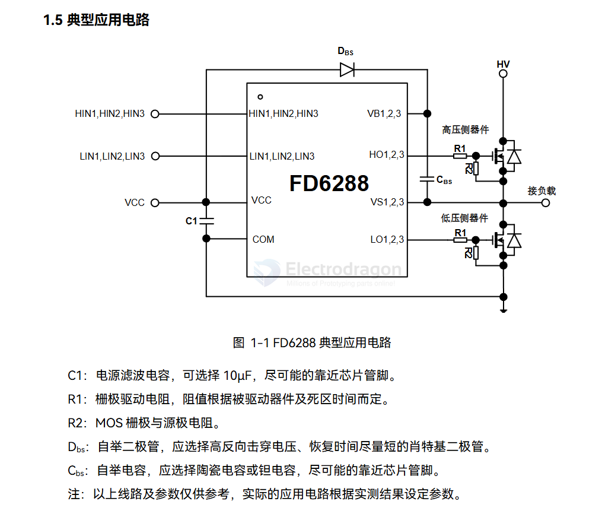
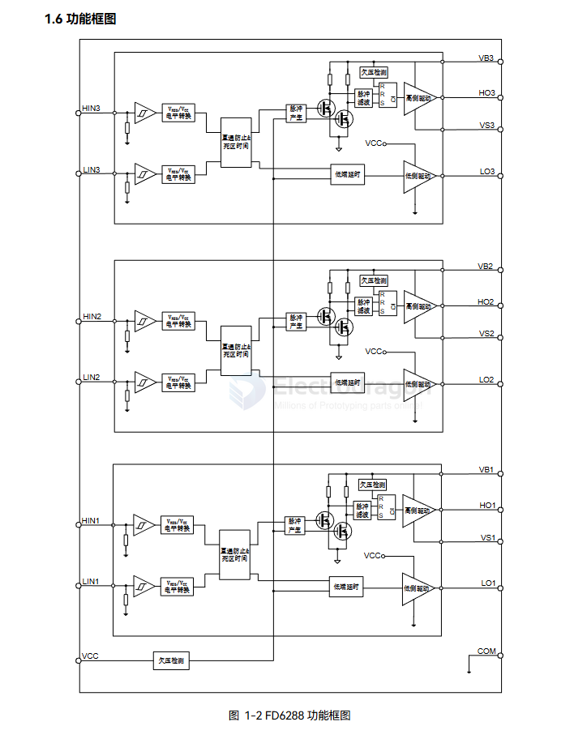

# FQ6288Q-dat

- [[fortier-dat]] - [[FD6288Q-dat]] - [[motor-driver-BLDC-dat]] - [[driver-gate-dat]] - [[driver-dat]]

1.1 概述 
FD6288 是一款集成了三个独立的半桥栅极驱动集成电路芯片，专为高压、高速驱动MOSFET 设计，可在高达+250V 电压下工作。 FD6288 内置VCC/VBS 欠压（UVLO）保护功能，防止功率管在过低的电压下工作。 

FD6288内置直通防止和死区时间，防止被驱动的高低侧 MOSFET 直通，有效保护功率器件。 

FD6288 内置输入信号滤波，防止输入噪声干扰。

1.3 产品特点
- 悬浮绝对电压+250V
- 电源电压工作范围：5.0~20V
- 集成三个独立的半桥驱动
- 输出电流+1.5A/-1.8A
- 3.3V/5V输入逻辑兼容
- Vcc/VB欠压保护（UVLO）
- 内置直通防止功能
- 内置200ns死区时间
- 内置输入滤波功能
- 高低端通道匹配
- 输出与输入同相

1.4 应用场景
电机驱动

Package

QFN-24-EP(4x4)

Description

-40℃~+125℃ 1.5A 1.8A 100ns 12ns 12ns 2.7V 3 300ns 330uA 5V~20V 800mV IGBT、MOSFET Three Phase Under Voltage Protection QFN-24-EP(4x4) Gate Drivers ROHS

- datasheet == [[FD6288q-ds.pdf]]

## SCH 

STD 

## diagram 

3x channels 

## ref 
