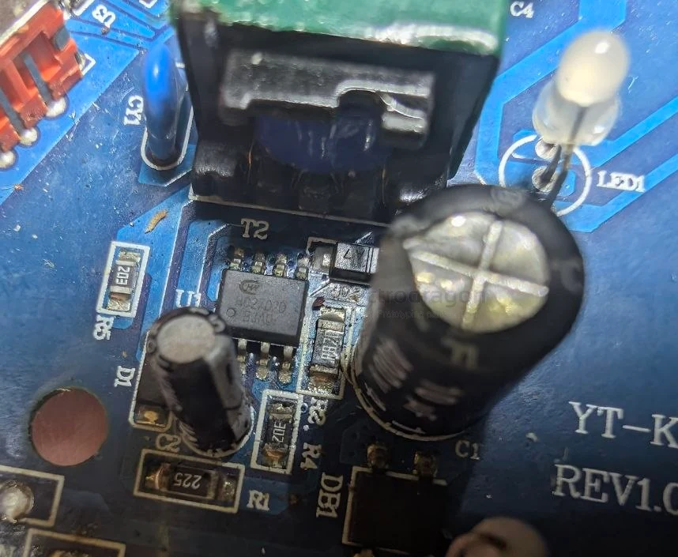

# HC2702-dat

- [[HC2702-dat]] - [[hcwsemi-dat]] - [[acdc-dat]] - [[acdc-PSR-dat]]

## HC2702D 

型号：	HC2702D
工作模式:	PSR
能效:	6
功能:	原边控制电源芯片
封装:	SOP-8
功率（W）:	10W
待机功耗（MW）:	75mw
工作电压:	85V-265V
应用:	充电器 适配器

## ref 