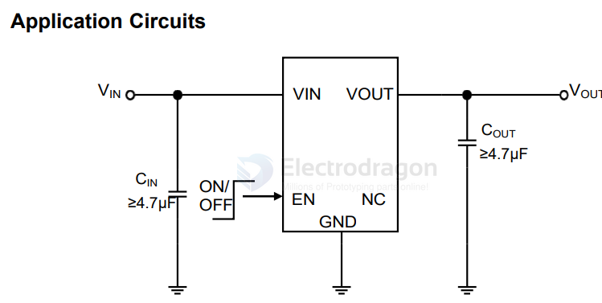

# heermicro-dat

- [[heermicro-dat]] - [[LDO-dat]] - [[HE9073-dat]]

HE9073 0.3uA IQ Series High Speed Low Noise LDO

Features
- Low power consumption:0.3uA (Typ.)Low voltage drop:
- 100mV@100mA@VOUT=3.3V(Typ.)
- High Output Current: ≥500mA
- Low temperature coefficient
- Integrated Short-Circuit Protection
- Over-Temperature Protection
- High input voltage (up to 7V)
- Output voltage accuracy: tolerance ±1%
- Build-in Enable/Output Current Limit circuit
- SOT23-5、SOT23-3、SOT89-3L、DFN1x1-4L
- package
- PSRR=70dB@1KHz
- Support Fixed Output Voltage :
- 1.0v/1.2v/1.5v/1.8v/2.5v/2.8v/3.0v/3.3v/3.6v/5.0v

Applications
- Battery-powered equipment
- Communication equipment
- Portable games
- Cameras, Video cameras

## ref 

