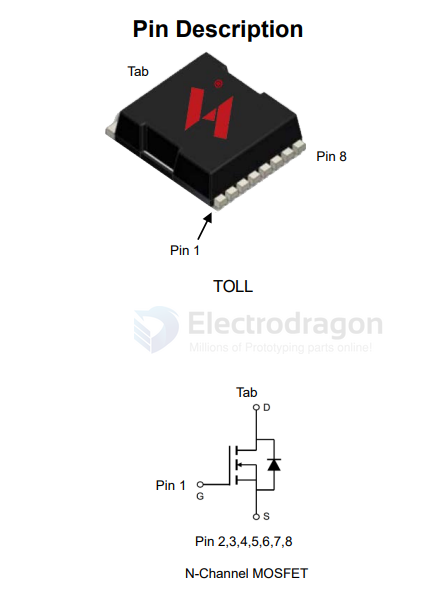

# HYG015N10NS1TA-dat

== ￥16.7 

- [[mosfet-dat]] - [[huayi-dat]] - [[HYG015N10NS1TA-dat]] - [[TOLL-dat]] - [[ESC-dat]] - [[PCB-footprint-dat]]

N-Channel Enhancement Mode MOSFET

Feature 
-  100V/380A RDS(ON)=1.2 mΩ(typ.)@VGS = 10V
-  100% Avalanche Tested
-  Reliable and Rugged
-  Halogen-Free Devices Available (RoHS Compliant)

Applications
-  Switching application
-  Power management for inverter systems
-  Battery management

## ref 