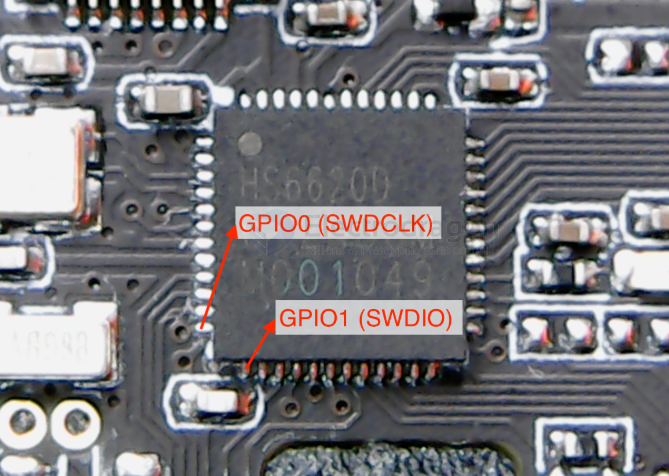

# HS6620-dat

- [[huntersun-dat]] - [[HS6620-dat]] - [[smart-watch-dat]] - [[electronics-consumer-dat]]

The HunterSun HS6620 (often designated as HS6620D) is a low-power system-on-chip (SoC) manufactured by HunterSun (OnMicro) widely used in budget-friendly smart wristbands, fitness trackers, and smartwatches (such as generic M-series, Y-series, or FitPro-associated devices).

Key Specifications (HS6620D)

- • Processor (MCU): 48 MHz ARM Cortex-M3
- • Memory: 256 KB ROM, 128 KB SRAM, and 1 MB internal / external SPI flash
- • Wireless Connectivity: Bluetooth 4.2 Low Energy (BLE) and proprietary 2.4 GHz
- • Power Consumption: ~5 µA in deep sleep mode (operating voltage 2.7V–3.6V)
- • Peripherals: Dual UART (with 7816 support), I2S, I2C, dual SPI, watchdog, RTC, three 32-bit timers, an 8x18 keyboard controller, a 3-axis quadrature decoder, and a 12-bit GP-ADC
- • Package Type: QFN48

Common Uses & Hacking

- • Devices: Found in low-cost wearable gadgets retailing typically between $15 and $50, often paired with companion mobile apps like FitPro or custom ad-hoc firmware.
- • Reverse Engineering: Security researchers and hobbyists have explored dumping RAM and flash contents (via SWD/GDB interfaces) to analyze how these generic trackers handle sensor data and Bluetooth communication.

- [[engineering-reverse-dat]]

## SWD connect 

- [[ARM-dat]] - [[JTAG-dat]]

## ref 