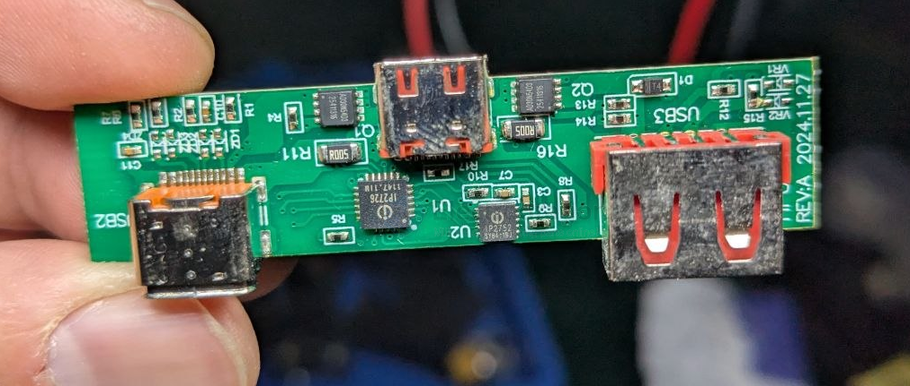

# IP2726-dat

- [[injoinic-dat]] - [[IP2726-dat]] - [[IP2752-dat]] - [[fast-charge-protocols-dat]]

The IP2726 is a multi-protocol fast-charging controller IC made by Injoinic Technology for USB-C and USB-A charging ports. It automatically detects connected devices and negotiates fast-charging profiles for wall adapters, car chargers, and power banks. You can view the IP2726 Datasheet for full electrical specifications, or check the IP2726H variant PDF from Injoinic.

Key Features

- • Supported Protocols: USB Type-C DFP, USB PD2.0 / PD3.0 / PPS, Qualcomm Quick Charge (QC2.0 / QC3.0 / QC4 / QC4+), Huawei FCP and SCP, Samsung AFC and 2.0A, MediaTek PE+ 1.1 and 2.0, Apple 2.4A, and BC1.2.
- • USB-C & Cable Handling: Detects Type-C device insertion and removal automatically and supports E-Marker cable recognition.
- • Power & Feedback Control: Controls output voltage via feedback (FB) loops and includes built-in power path management, automatic discharge control, and low-power standby mode.
- • Protections: Provides output over-current, over-voltage, and short-circuit protection, NTC over-temperature protection, and DP/DM/CC1/CC2 fault protections.

Variants & Sourcing

• IP2726_AC_FBR_NP18W: Listed on LCSC as a QFN-24-EP multi-protocol IC supporting 1A1C configurations.
• IP2726 (QFN-24): Listed on JLCPCB Assembly with 0 units in stock for direct purchase, though consigned parts can be used for PCBA orders.

## build 

AD30N54D3 - [[mosfet-dat]] - [[AD30N54D3-dat]] - [[ADAMANT-dat]] - [[IP2726-dat]]

## ref 