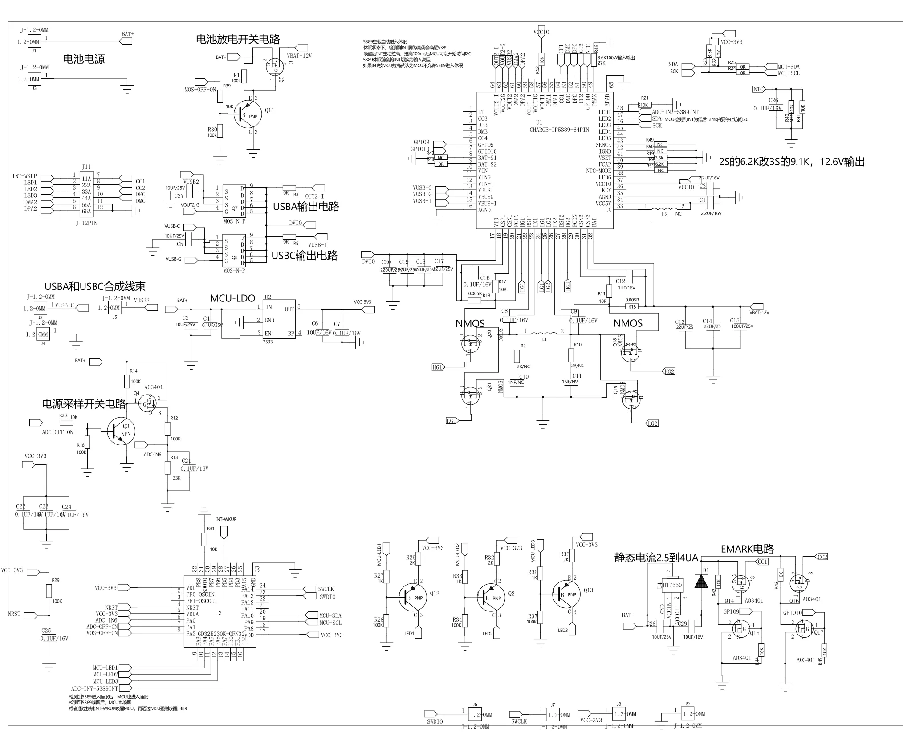

# IP5389-dat

- [[IP5389-dat]] - [[injoinic-dat]] - [[power-bank-dat]] == 100W

The IP5389 is a power management SoC made by Injoinic Technology for high-power, fast-charging power banks and portable power supplies up to 100W.

Key Specifications & Features

• Power & Architecture: Synchronous bidirectional buck-boost converter supporting up to 100W input/output using a single inductor and a 14-bit ADC fuel gauge.
• Battery Support: Compatible with 2 to 5 series cells (Li-ion/LiPo at 4.15V–4.4V or LiFePO4 at 3.65V) with up to 8A charging current.
• Fast Charging Protocols: Supports USB-C PD 2.0/3.0 (bidirectional) and PPS output (3.3V–21V / 3A), along with QC2.0/3.0/3+, AFC, FCP, SCP, VOOC, BC1.2, and Apple 2.4A.
• Ports & Multi-Port Behavior: Supports up to four ports (such as 2x USB-A, 1x USB-C, and an extra input/output port). Fast charging works when a single output port is used, but output drops to 5V across ports when two or more output ports run simultaneously.
• Package & Protections: Comes in an 8mm × 8mm QFN-64 package with over-voltage, under-voltage, over-current, short-circuit, IC/NTC battery temperature protection, and 4kV ESD protection.

## SCH 

build 1 

## ref 