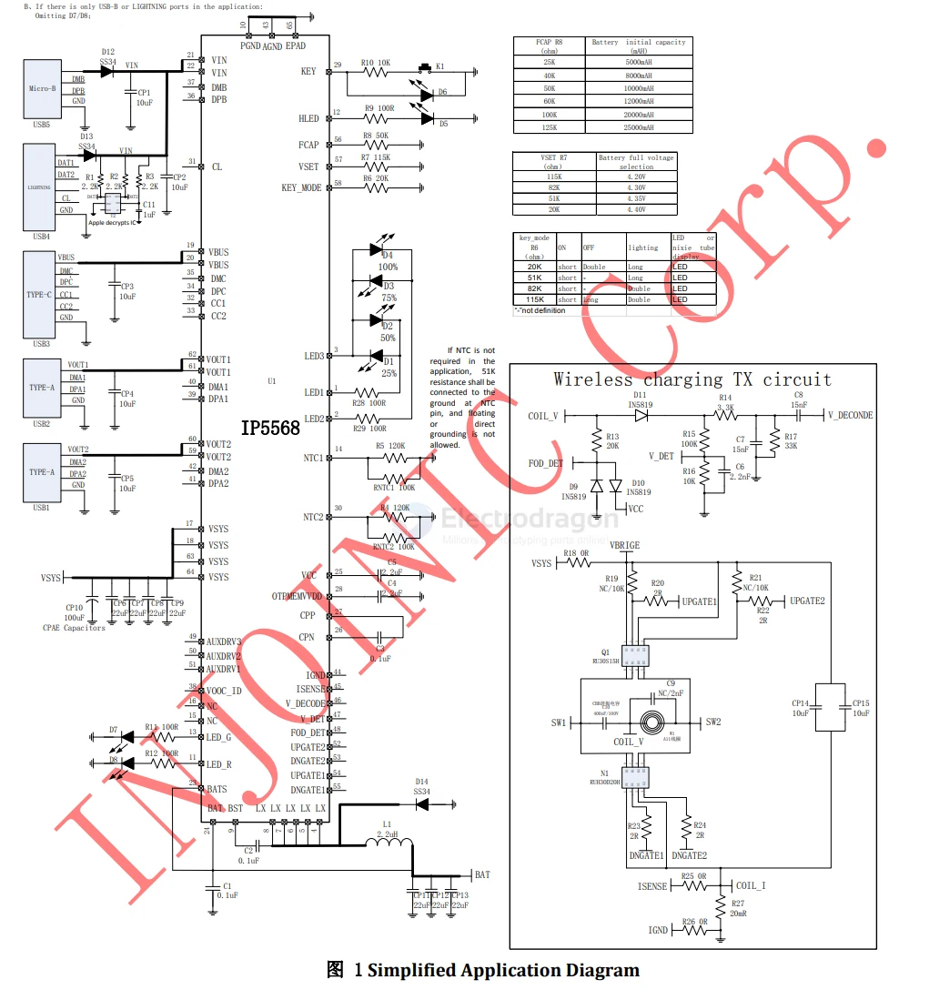
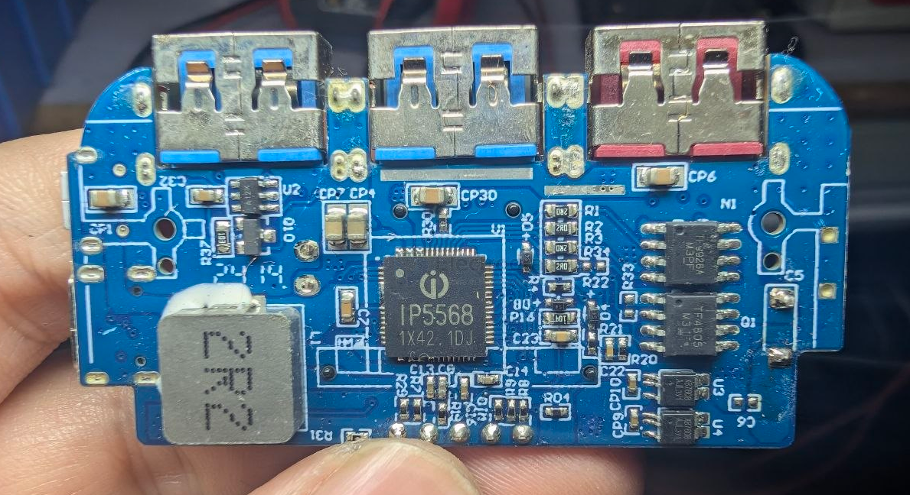
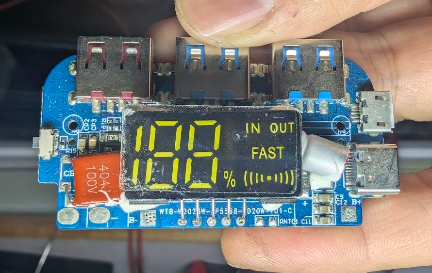

# IP5568-dat

- [[IP5568-dat]] - [[injoinic-dat]] - [[power-bank-dat]]

- [[fast-charge-protocols-dat]] - [[USB-PD-dat]]

Support wireless charging TX/RX 、SCP、VOOC、Bi-directional PD3.0 and Fast Charge protocol Power Bank SOC

- [[ip5568-datasheet-58966068.pdf]]

## APP 

## build 

- [[XB7608-dat]] 

TF4805 - [[Tuofeng-dat]] - [[mosfet-dat]]

TF9926A - [[Tuofeng-dat]] - [[mosfet-dat]]

- [[IP2112-dat]] - `A12K` - [[fast-charge-protocols-dat]] - [[IP5568-dat]]

## ref 

