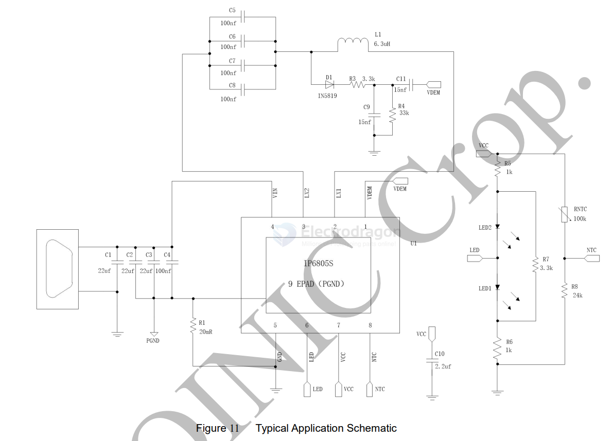
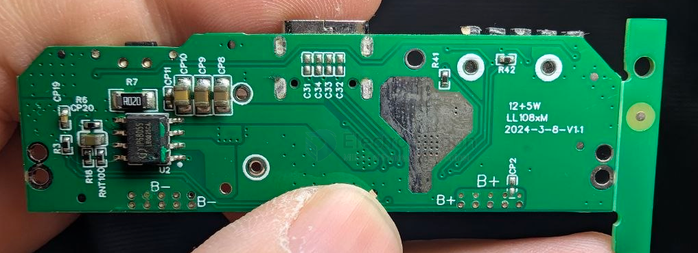

# IP6805-dat

- [[IP6805-dat]] - [[injoinic-dat]] - [[power-wireless-dat]] - [[power-wireless-TX-dat]]

## SCH 

## build 

- [[SW6003-dat]] - [[IP6805-dat]] 

TX on the back side at - [[SW6003-dat]]

## ref 

DS == [[IP6805S-DS]]
